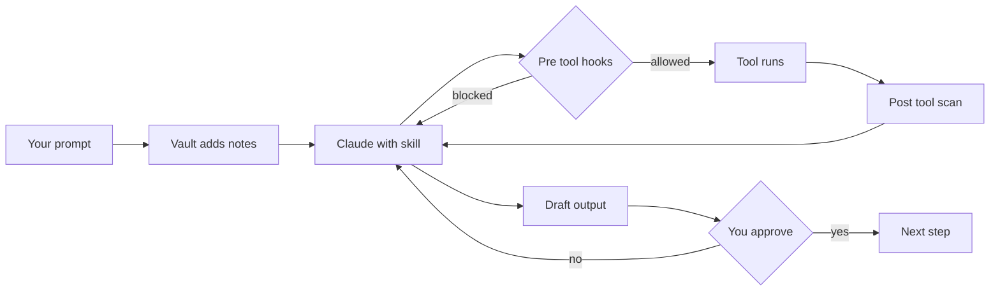
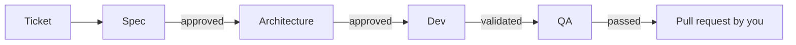

# Arbiter

**A governed harness for Claude Code. Claude proposes, you approve.**

Context engineering, structured skills and PHI safeguards take each ticket from specification to review, with human approval at every checkpoint.

Created by Dipen Patel.

## Why it exists

An AI assistant doing real data work fails in three predictable ways. Arbiter closes each one.

| Failure | What Arbiter does |
|---|---|
| It forgets between sessions | **Context engineering.** Every prompt is searched against your notes vault and relevant excerpts are injected. Standards, memory and per ticket state files load automatically. |
| It skips steps | **A skill chain with gates.** Spec, architecture, build and QA are separate roles with defined handoffs. Hooks refuse to start a later step until the earlier one is approved. |
| It sees or writes what it should not | **Guardrail hooks.** PHI, credentials, sensitive paths, writes outside the working folder and Databricks row queries are checked before and after each tool call. |

What happens on every prompt:



## How a ticket moves

`{prefix}` is the skill prefix you choose at install. It drives the slash command names, so prefix `dp` gives `/dp-ticket`. Session skills such as `/start` and `/close` carry no prefix.

```
Coordination:  /start → /{prefix}-ticket → /close
Bug:           /start → /{prefix}-ticket → support → spec → arch → dev → qa → /close
Build:         /start → /{prefix}-ticket → spec → arch → dev → qa → /close
```



Each skill is a role: product manager, architect, engineer, adversary. State is written to the vault in `02-tickets/{KEY}/{KEY}-state.md`, so any session picks up where the last one stopped. Every output is a draft. Nothing is sent or committed without you.

See the [Walkthrough](docs/walkthrough.md) for a full bug ticket with fake data.

## Repo layout


## Vault layout

The installer creates the vault. Skills read from it and write to it.


## Safeguards and their limits

Hooks block or ask before PHI or credentials are written, run in a command, or returned by a tool. They also ask before reading sensitive paths and before Databricks commands that return rows.

PHI detection is a safety net built from fixed text patterns. It does not understand meaning, it raises false alarms, and it is not deidentification. It misses names with no nearby clue, non US formats, images and PDFs, and anything typed in the chat prompt. When it fires, replace the value with a placeholder. Do not add an exception. The levels, the rules and the full list of what is not caught are in the [Hook Reference](docs/hooks.md).

## Quick start

1. Collect your tokens: see [Prerequisites](docs/prerequisites.md).
2. Clone the repo and run `./install.sh`. It sets up your identity, vault, symlinks, MCP servers and search index. Tokens go to the OS credential store (on Linux without `secret-tool`, a private file).
3. Reload your shell, open VSCode and run `/start`.

Details: [Setup](docs/setup.md). Python 3.9 or later is required.

## Documentation

| Read | Covers |
|---|---|
| [Overview](docs/overview.md) | What the system is and why |
| [Skill Chains](docs/skill-chains.md) | Which chain for which ticket |
| [System Design](docs/system-design.md) | Architecture and how to adapt it |
| [Hook Reference](docs/hooks.md) | Every hook, with testing and recovery |
| [File Structure](docs/structure.md) | Where everything lives |
