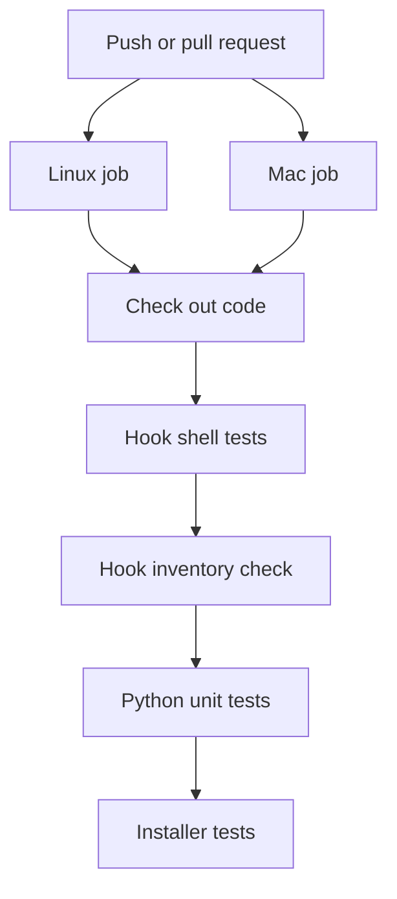

## Purpose

A GitHub Actions workflow named `tests`. It runs the hook tests and the installer tests on Linux and macOS each time code is pushed or a pull request is opened. {src:.github/workflows/tests.yml:1}

## Dependencies

Read by GitHub Actions. It runs `tests/hooks/run.sh`, `tests/hooks/check_hook_inventory.py`, the `test_*.py` files in `tests/hooks`, and `tests/installer/run.sh`. {src:.github/workflows/tests.yml:21} It uses the `actions/checkout` action at version 7. {src:.github/workflows/tests.yml:19} Related docs: [check_hook_inventory](../../tests/hooks/check_hook_inventory.md), [run](../../tests/hooks/run.md).

## Behavior

Triggers: every `push` and every `pull_request`, with no branch filter. {src:.github/workflows/tests.yml:3}

Token rights: the workflow grants `contents: read` only. {src:.github/workflows/tests.yml:7}

One job, `test`, runs once per operating system: `ubuntu-latest` and `macos-latest`. {src:.github/workflows/tests.yml:12} `fail-fast` is false, so one failing system does not cancel the other. {src:.github/workflows/tests.yml:14}

Steps, in order:

| Step | Command |
|---|---|
| Check out repository | `actions/checkout@v7` {src:.github/workflows/tests.yml:19} |
| Hook shell tests | `bash tests/hooks/run.sh` {src:.github/workflows/tests.yml:22} |
| Hook inventory check | `python3 tests/hooks/check_hook_inventory.py` {src:.github/workflows/tests.yml:25} |
| Python unit tests | `python3 -m unittest discover -s tests/hooks -p 'test_*.py'` {src:.github/workflows/tests.yml:28} |
| Installer tests | `bash tests/installer/run.sh` {src:.github/workflows/tests.yml:31} |

A step that exits non zero fails the job. No step sets `continue-on-error`. {src:.github/workflows/tests.yml:18}

## Diagram

## Notes

The end to end test, `tests/e2e/run.sh`, is not in this workflow. {src:.github/workflows/tests.yml:18} `docs/hooks.md` describes it as a separate manual layer that needs a real Claude session. {src:docs/hooks.md:569}

No Python version is pinned. The jobs use the `python3` on each runner image. {src:.github/workflows/tests.yml:25}

`tests/hooks/run.sh` itself runs the inventory check and the `test_*.py` discovery. {src:tests/hooks/run.sh:183} {src:tests/hooks/run.sh:191} The workflow then runs both again as separate steps, so each runs twice per system. This matches `docs/hooks.md`, which says `run.sh` includes them. {src:docs/hooks.md:568}
