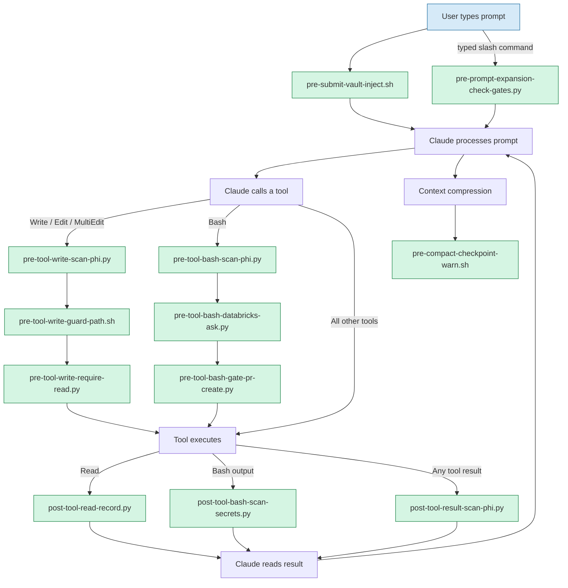
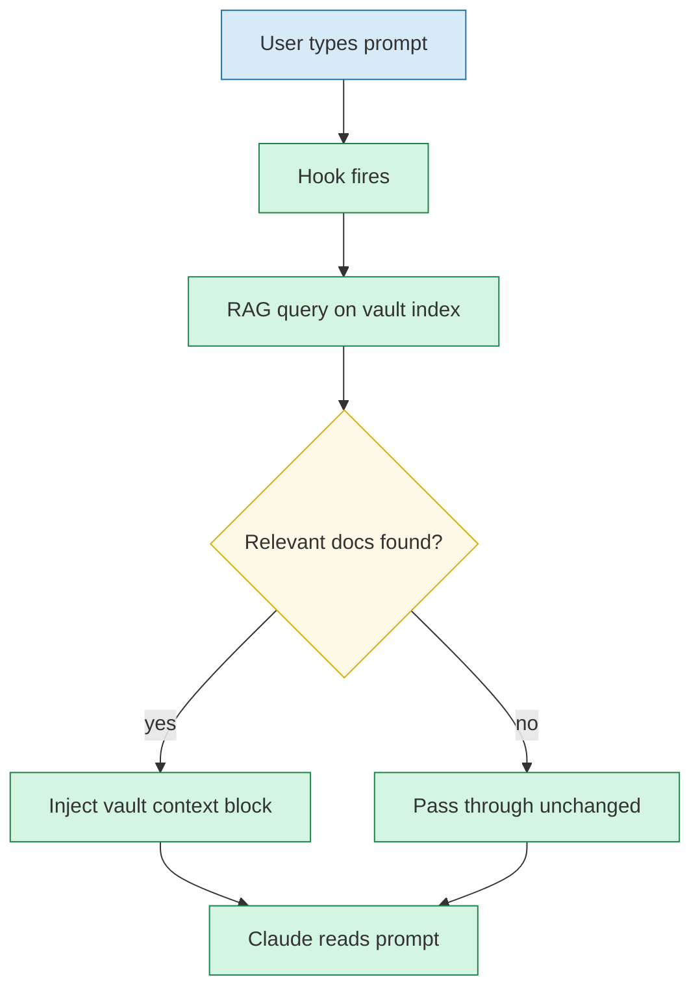
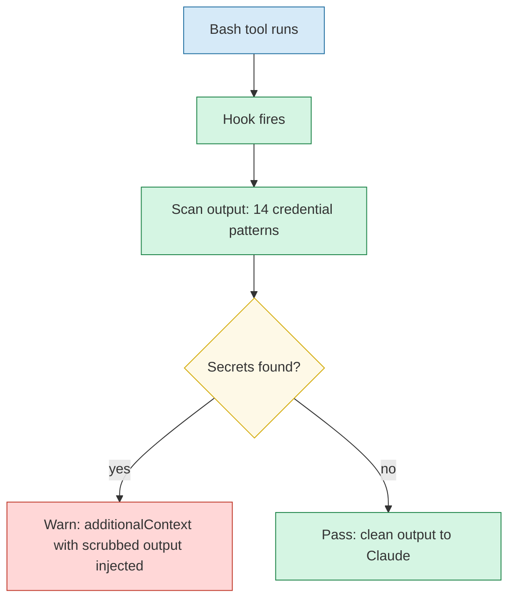
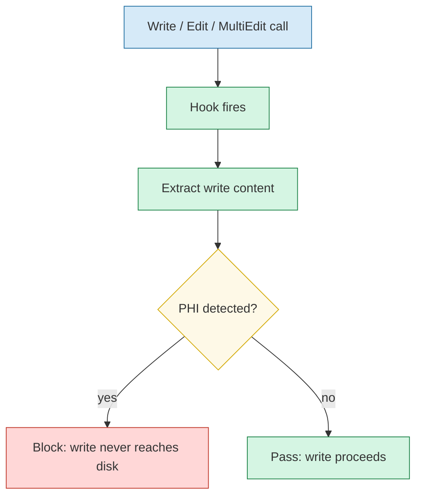
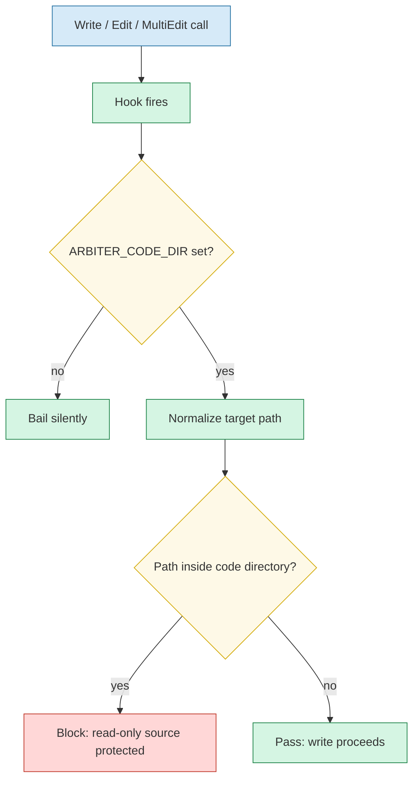
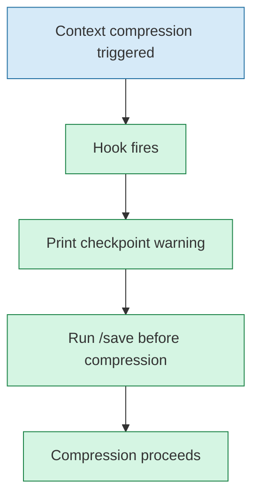
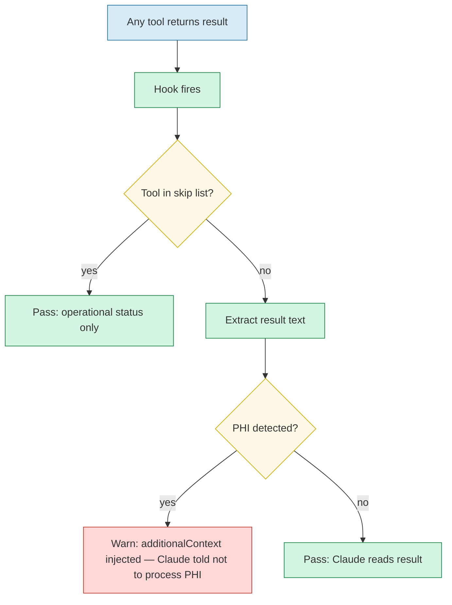
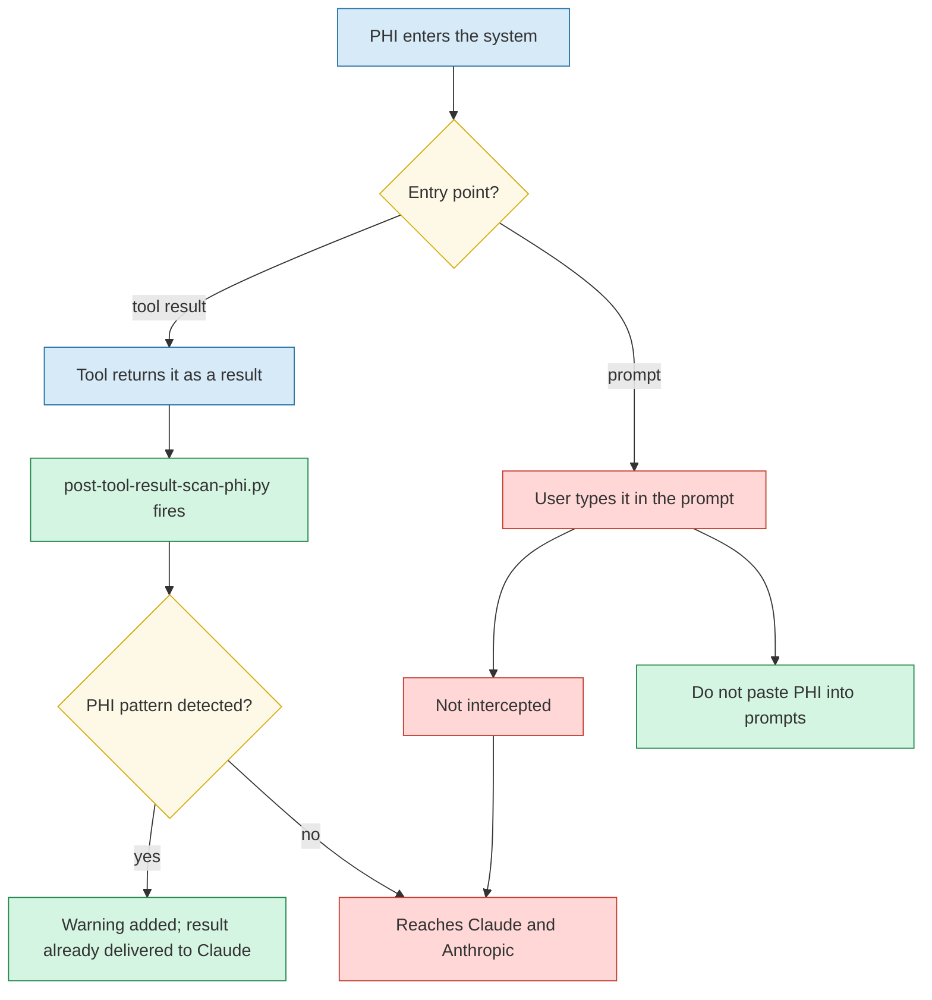

# Hook Reference

Created by Dipen Patel.

Claude Code hooks are shell or Python scripts that fire at defined points in the agent loop. Arbiter wires twelve hooks across four events in `settings.json`, plus four shared modules (`hooks/state_file_io.py` for atomic, locked writes to state files, `hooks/phi_patterns.py` for PHI detection and payload text extraction, `hooks/sql_summary.py` for the Databricks approval summary, `hooks/read_guard_common.py` for the read before write guard) and two git hooks that are not Claude Code hooks (`hooks/git-pre-push`, `hooks/pre-commit-secrets`; see section 13). `python3 tests/hooks/check_hook_inventory.py` fails if a hook file, `settings.json` and this page disagree. Each section below shows what the hook does and when it fires.

Hooks are defined in the repo `settings.json` and merged into `~/.claude/settings.json` with absolute paths by `installer/merge_settings.py`. The merge keeps your own hooks, permissions, env, and other settings, and replaces only Arbiter's hook entries (including stale paths from a moved repo). It also writes an `env` block (`ARBITER_KNOWLEDGE`, `ARBITER_CODE_DIR`, `CLAUDE_DOTFILES`) so hooks work in editors launched without your shell profile.

## Output format (required)

Claude Code validates hook JSON. `hookSpecificOutput` **must** include `hookEventName` matching the event. Without it, Claude Code logs `Hook JSON output validation failed — hookSpecificOutput is missing required field "hookEventName"`, marks the hook as an error, and discards its output: no warning reaches Claude and no deny takes effect. Verified on Claude Code 2.1.220 (2026-09-23). Every Arbiter hook before that date omitted the field, so none of them worked in live sessions even though fixture tests passed.

```json
{"hookSpecificOutput": {"hookEventName": "PreToolUse", "permissionDecision": "deny", "permissionDecisionReason": "..."}}
{"hookSpecificOutput": {"hookEventName": "PostToolUse", "additionalContext": "..."}}
```

UserPromptSubmit and PreCompact hooks here print plain text, which does not need the field.

Real payload shapes (captured live, used by `phi_patterns.collect_texts`):
- Bash `tool_response`: `{"stdout", "stderr", "interrupted", "isImage", "noOutputExpected"}`
- Read `tool_response`: `{"type": "text", "file": {"filePath", "content", ...}}`, with the text nested under `file.content`

## What hooks can and cannot do

| Event | Can | Cannot |
|---|---|---|
| PreToolUse | Block (`deny`) or require approval (`ask`) before the tool runs. `ask` overrides an allow rule (verified). | See the result |
| PostToolUse | Add a warning for Claude (`additionalContext`) | Hide, redact, or undo a result. Claude has already received it. |

Controls that must prevent exposure belong in PreToolUse. PostToolUse is a second layer.

## Fail closed vs fail open

- `pre-tool-write-scan-phi.py` **fails closed**. An unreadable payload, an import error, or any exception denies the write.
- `pre-tool-bash-databricks-ask.py` fails to `ask`.
- `pre-tool-bash-scan-phi.py` **fails closed** (owner decision, 2026-11-01). Bad JSON, an import error, or any exception denies the command with an "internal error" message. It used to fail open so Bash could be the recovery path; that path is gone, see Recovery.
- `pre-tool-bash-gate-pr-create.py` fails open on internal errors, except that a command it cannot parse falls back to a text match.
- `pre-prompt-expansion-check-gates.py` **fails open** (design decision). Bad JSON, an import error of `gate_rules.py`, a rule error or any other exception is logged as `fail_open` and the command goes ahead. A broken gate check must not lock you out of the chain skills; the cost is that a bug lets a skill start without its approval lines, so read the log (below) now and then.
- `pre-tool-write-require-read.py` and `post-tool-read-record.py` fail open: a logging or parsing problem never blocks work.

**What fail closed covers.** The two PHI pre hooks deny when they catch an error themselves: bad or wrongly shaped input, a missing or broken `phi_patterns.py`, or any exception inside the scan. Claude Code treats a hook that cannot start, exits with a code other than 0 or 2, prints invalid output, or is cancelled by its timeout as a non blocking error, and the action goes ahead (source: Claude Code hooks documentation, checked 2026-11-02). So a hook file with a syntax error, or a missing `python3`, does not block. Timeouts: the documented default for a command hook is 600 seconds, and `settings.json` sets none on these hooks. Measured scan times are in "PHI scan speed limits" below.

---

## Hook event map



---

## 1. pre-submit-vault-inject.sh

**Event:** UserPromptSubmit — fires before every prompt reaches Claude.

Queries the vault RAG index and injects matching document excerpts into the conversation. Claude reads your vault context without you pasting it manually.



**Path portability:** The script derives its own location from `BASH_SOURCE[0]` so it works after the dotfiles directory is renamed or moved.

---

## 2. post-tool-bash-scan-secrets.py

**Event:** PostToolUse — fires after every tool call (empty matcher; Write, Edit, MultiEdit, NotebookEdit, and TodoWrite are skipped). Scans Bash stdout and stderr, Read file content, and MCP text.

Scans tool output for credentials. When a match is found the hook injects an `additionalContext` warning into Claude's turn with a scrubbed copy of the output. It does not redact what Claude received. **PostToolUse hooks cannot suppress a result from reaching Claude** — the raw output and the warning both reach Claude. The hook instructs Claude not to act on raw credential values.

> **Limitation:** Secrets in Bash output reach Claude's context. The hook reduces the risk that Claude will reproduce or forward them, but does not eliminate it.



**Patterns covered:** Anthropic key, AWS access key, Jira token, Databricks PAT, GitHub PAT, GitHub token, Slack token, OpenAI key, Azure storage key, Azure SAS, PEM private key, auth header, credential assignment, exported env secret.

---

## 3. pre-tool-write-scan-phi.py

**Event:** PreToolUse — fires before Write, Edit, MultiEdit, and NotebookEdit.

Scans the content being written to disk (`content`, `new_string`, each MultiEdit `new_string`, `new_source`) with `scan_levels`: the labeled identifier rules, the context rules, and PHI columns in CSV or JSON row dumps. The target path is not scanned. The strongest finding sets the outcome: deny blocks the write, ask makes Claude Code prompt you, warn lets the write follow the normal permission flow and adds a visible message. The message names rules and levels, never the matched text. Fails closed on errors it catches.



**Rules covered:** see "PHI detection levels and rules" below.

---

## 4. pre-tool-write-guard-path.sh

**Event:** PreToolUse — fires before Write, Edit, and MultiEdit.

Blocks writes to the read-only code directory (`ARBITER_CODE_DIR`). That directory is a RAG source mirror of production repos and must never be written to. If `ARBITER_CODE_DIR` is not set the hook does not block, but it prints a visible warning (a `systemMessage` plus the same text on stderr) so an unprotected setup is not silent. Bash writes into the same directory are covered by section 12.



**False positive guard:** Path comparison uses a trailing slash on both sides (`/code/` vs `/codebackup/`) so a directory whose name starts with the code dir name does not trigger a false block.

**Gate override files:** the same hook denies any model write to a file named `*-gate-override.md` (any letter case, also through a symlink), with the message that the owner creates it from a terminal. This check runs first, so it holds even when `ARBITER_CODE_DIR` is unset. The Bash tool is not covered: a shell command can still create the file, so the override is a guard against accidents, not against a determined actor. See section 13 for the terminal command.

---

## 5. pre-compact-checkpoint-warn.sh

**Event:** PreCompact — fires before Claude Code compresses the context window.

Writes a checkpoint reminder to Claude Code's debug log before compaction fires. **This output does not reach Claude's context or the user's terminal.** PreCompact stdout goes to the debug log only; the feature request to allow PreCompact to inject into Claude's context (GitHub #43733) was closed as "not planned." The only user-visible PreCompact signal is `exit 2` with stderr output, which hard-blocks compaction entirely.

> **Current status: this hook is a functional no-op.** The warning reaches no one. If you want to preserve state across compaction, use `SessionStart` with an injected summary file written by a PreCompact side-effect instead.



---

## 6. post-tool-result-scan-phi.py

**Event:** PostToolUse — fires after every tool call (empty matcher).

Scans every tool result for PHI before Claude reads it. Covers Bash (Databricks CLI, git), Read (files), and all MCP tools (Jira, Notion, Slack, Databricks, any future connection). Write, Edit, MultiEdit, and TodoWrite are skipped because they return operational status, not external data.

**PostToolUse hooks cannot suppress results.** When PHI is detected, the hook injects an `additionalContext` warning that lists each finding with its level, for example `PHONE (ask)`. If the strongest finding is deny or ask, the note starts with "PHI DETECTED" and tells Claude not to process, store, log, or forward the data. If every finding is warn, the note says "Weak PHI signal", says it may be a false alarm, and asks Claude to check whether the data identifies a person before storing or forwarding it. The raw result still reaches Claude.

> **Limitation:** PHI in tool results reaches Claude's context. The hook instructs Claude to halt processing, but does not technically prevent the data from being seen.



**Skip list:** Write, Edit, MultiEdit, TodoWrite.

**Rules covered:** the same rules as the write hook, applied to tool results by `scan_levels`. See "PHI detection levels and rules" below.

**Why this is the critical gate:** MCP tools are the primary channel through which production data enters Claude's context. A Databricks query, a Jira issue, or a Notion page can all return PHI. This hook intercepts at the seam between external systems and Claude's context window, which is the last point before data enters the Anthropic API request body.

---

## PHI scrubbing: what it covers and what it does not

The PHI hooks use fixed text patterns. They catch labeled identifiers, dates next to birth words, full street addresses, names right after a patient label, and combinations of weak clues (see "PHI detection levels and rules" below). They do not read intent, and anything outside those shapes passes. The README lists what is not caught.

### What the hooks catch

The write and Bash hooks scan before the action runs. The result hook scans after the tool has run, so what it flags is already in Claude's context.

| Surface | Hook | Example caught |
|---|---|---|
| Bash command text, including heredocs and inline data | `pre-tool-bash-scan-phi.py` | An echo that writes a patient label and a capitalized name into a file |
| Script files named in a Bash command, read and never run | `pre-tool-bash-scan-phi.py` | `python3 run.py` where `run.py` holds a full street address |
| File content being written to disk | `pre-tool-write-scan-phi.py` | Write call containing `MRN: 9876543` |
| Bash command output | `post-tool-result-scan-phi.py` | Databricks CLI returning a row with `patient_id: 84729` |
| File content being read | `post-tool-result-scan-phi.py` | Read call returning a CSV with `SSN: 123-45-6789` |
| MCP tool result (Jira, Notion, Slack, Databricks) | `post-tool-result-scan-phi.py` | Jira issue body containing `DOB: 03/15/1982` |

**Structured patterns the hooks detect:**

| Identifier | Example that triggers a block |
|---|---|
| MRN | `MRN: 1234567`, `MRN#9876543`, `MRN 0045221` |
| SSN | `SSN: 123-45-6789`, `SSN 123-45-6789`, `SSN on file: 123-45-6789` — requires `SSN` or `social security` keyword; bare digits alone are not caught |
| Date of birth | `DOB: 03/15/1982`, `date of birth: 1/5/80`, `born: 12/31/1975` |
| Patient or member ID | `patient_id: 84729`, `member id: 00234`, `pt id: 9922` |
| NPI | `NPI: 1234567890` |
| Insurance or policy ID | `insurance_id: ABC123456`, `policy_number: XY-99001`, `subscriber_id: Z889900` |

### PHI detection levels and rules

`phi_patterns.scan_levels` returns findings, each with a level. The strongest level decides the outcome in the pre hooks.

| Level | Pre hook outcome | Rules at this level (verified in `phi_patterns.py`) |
|---|---|---|
| deny | `permissionDecision: deny` | The labeled identifier rules above, a date next to a birth word (also with month names, "born on" and "birthday"), a full street address (number, street words, street suffix, city, two letter state, ZIP), a capitalized name right after a patient, member or pt label (`NAME`), PHI column names that come with data (`COLUMN`, the column name itself is never shown). A label missing from the level map also defaults to deny. |
| ask | `permissionDecision: ask` | A phone number next to a phone label (`PHONE`). Two clues of different kinds within 200 characters (`CONTEXT`). |
| warn | No permission decision. A `systemMessage` and `additionalContext` are added and the normal permission flow runs. | A lone titled name (`Mr`, `Mrs`, `Ms`, `Mx` plus two capitalized words), a lone age with a sex word or `y/o`, or a lone date next to an admission, discharge, visit, surgery or procedure word (`CONTEXT_CLUE`). A phone number with separators and no label (`PHONE_UNLABELED`). |

Clue kinds are name, age and sex, event date, street part, phone and clinical term. A clinical term comes from a short list of generic words, with no drug or disease names. A street part alone and a clinical term alone are never findings. Clues whose text overlaps never pair, so one word cannot count twice. Large text is scanned in 64 KB pieces that overlap by 1 KB.

A pre hook message lists rule labels and levels only, never the matched text. `scan_for_phi` and `scan_structured` are the strict block rules. They keep their original outputs for the original labels and also gained the date of birth with a month name rule and the street address rule, so text that passed before can now be blocked. The vault inject hook withholds an excerpt that has a finding at any level.

### What the hooks do not catch

**1. User-typed PHI in the chat prompt.**
If you paste a patient record directly into the chat, that text goes to Anthropic before any hook can intercept it. No hook scans what you type — only what tools return.

What to avoid:
```
❌ "Here is the patient record: MRN 1234567, DOB 03/15/1982, SSN 123-45-6789. Help me debug this."
```

What to do instead:
```
✅ "The TAVR encounter record is missing encounter_date. 14 of 500 records have this issue. Help me debug the null check."
```

**2. Text with no clear clue.**
Names, addresses, dates and clinical notes are caught only in the shapes listed under "PHI detection levels and rules". A name with no patient label or title next to it, an address missing its city, state or ZIP, a date with no birth or care word nearby, and a clinical note with no personal clue all pass. A lone weak clue gives a warn at most. The README has the full list of what is not caught.

**3. PHI already in the conversation from an earlier turn.**
If PHI entered Claude's context before a hook was active — for example, from a prompt you typed before the hook was installed — it remains in the conversation history that Anthropic receives on every subsequent turn. Hooks only gate new data as it enters; they do not scrub existing context.

**4. PHI in images or screenshots.**
Claude can read images. PHI visible in a screenshot of a patient dashboard or a lab report is not scanned by any hook.

### The rule that no hook can replace

Do not paste patient-level data into the chat. Work at the aggregate level.

| Instead of | Use |
|---|---|
| A query result showing individual rows with MRNs | A row count: "14 of 500 records failed" |
| A specific patient's record as an example | An anonymized example with the field names and value types, not real values |
| A real MRN in a bug report | A placeholder: `MRN: XXXXXXX` |
| A full encounter record in a Jira comment | The encounter type and the field that failed: "TAVR, encounter_date: NULL" |

The hooks are a defense layer, not a replacement for data hygiene. They catch mistakes. Your judgment prevents them.



---

## 7. pre-tool-bash-scan-phi.py

**Event:** PreToolUse — fires before every Bash command.

Scans the command text, and the script files the command names, with `scan_levels`. Deny blocks the command, ask makes Claude Code prompt you, warn adds a visible message and lets the normal permission flow run. The message lists sources and rule labels only, for example `Bash command text` or `script file run.py`, never the matched text.

**Script file scan.** The command is split with `shlex`. For `python`, `python3`, `bash`, `sh`, `zsh`, `node`, `source` or `.`, and a command that starts with a path, the named file is read and scanned with the same rules. Wrappers (`sudo`, `env`, `nohup`, `time`, `exec`, `command`) and leading `VAR=value` words are skipped. At most 10 files per command. The file is only read, never run. A file larger than 256 KB is read in 256 KB blocks that overlap by 1 KB, so a value on a block edge is still found. The scan is best effort and degrades to the command text alone, never blocking, when the file is missing, unreadable, a directory or pipe, binary (a null byte in the first 8 KB), a path the system rejects, or the command cannot be parsed. Inline code (`-c`, `-m`, `-e`, `-p`) and a script read from stdin name no file. A command longer than 32,768 characters is not parsed, so its script files are not read, but its text is still scanned in full.

**Fails closed.** If the hook cannot run (bad payload, a payload of the wrong shape, missing `phi_patterns.py`, any exception in the core scan) it denies the command and says why. Decision by the owner on 2026-11-01: an unscanned command is treated as unsafe. Cost: a broken hook blocks all Bash, so fixes happen in an editor outside Claude Code (see Recovery). This covers errors the hook catches; see "What fail closed covers" above for the cases Claude Code treats as non blocking.

> **Known limits:** PHI that a script builds, fetches or writes at run time is not in the command text or the file, so it passes. Split or encoded strings (concatenation, base64) dodge the patterns. Scripts reached through variables, `cd`, `-m module`, `xargs` or pipes are not found. The file can change after the scan. `post-tool-result-scan-phi.py` still scans anything the script prints, but only after it is in Claude's context. Tests that pin these limits: `test_known_limit_script_writing_phi_is_not_caught`, `test_f06_split_value_in_script_passes`, `test_command_over_parse_cap_is_text_scanned_only`. If one of them starts failing, the limit moved and this page must change.

### PHI scan speed limits

Every repeat in the PHI patterns has an upper limit, because an open ended whitespace repeat on both sides of a separator once made the cost grow with the square of the run length (the old pattern took 2.9 seconds on 20,000 spaces after a label, measured). `tests/hooks/test_phi_safety_speed.py` holds the time budgets: 1 MB of clean text must scan in under 5 seconds, and 256 KB of adversarial text (long runs of whitespace, digits, label like words, packed near miss clues) in under 3 seconds each. On the development machine the worst cases measured about 2 seconds per MB, clean text about 0.5 seconds per MB, and a hook process adds about 35 milliseconds of start up. Run `PHI_TIMING_REPORT=1 python3 -m unittest discover -s tests/hooks -p 'test_phi_safety_speed.py'` to print the times on your machine.

## 8. pre-tool-bash-databricks-ask.py

**Event:** PreToolUse — fires before every Bash command. Acts only on Databricks CLI commands that return or copy row data. Verified against Databricks CLI v1.2.1:

- `api post|get` on `/sql/statements`
- `fs cat`, `fs cp`
- Genie query commands
- `jobs get-run-output`, `export-run`
- `workspace export`, `export-dir`
- `query-history list`

Metadata commands (catalogs, schemas, tables list/get, `fs ls`) pass through.

**Also gated (same deny, then ask flow):**
- Python (`python`, `uv`, `pyspark`, heredocs, `dbsqlcli`) that uses `databricks.sql`, `databricks_sql`, SDK row calls, `spark.sql`, `spark.table`, `spark.read` or `DatabricksSession`
- `curl`, `wget` or `http` against a workspace host, `$DATABRICKS_HOST` or an `/api/2.x/sql` path

**Not gated (known limits):** scripts run from a file, jobs and notebooks running inside Databricks, MCP tools, JDBC/ODBC/BI clients, dbt, obfuscated commands, hosts not named in `DATABRICKS_HOST`, other languages. Each of these can return row data without this approval step.

**Flow (deny first, then ask):**
1. First attempt: the hook returns `deny` with a summary and an approval code. The code is an 8 character hash of the exact command.
2. Claude shows the summary in chat and asks you.
3. If you approve, Claude re-runs the identical command prefixed with `ARBITER_DATA_APPROVED=<code>`.
4. The hook checks the code against the command and returns `ask`, so the normal Yes/No dialog appears for your final click.

Any change to the command changes the code, so it is blocked again with a new summary. Approving one query cannot release another.

**Why not a plain `ask`:** in the VS Code extension, no hook output reaches you before the approval click (verified 2026-09-23). `permissionDecisionReason` is not shown in the dialog, and `systemMessage` appears only after the command has run. A `deny` reason reaches Claude immediately, so the summary comes to you through chat. CLAUDE.md guardrail 13 tells Claude never to add the code without your approval. If it did, the code would still be visible in the command in the Yes/No dialog.

The summary covers what is being pulled:

- **Parsed from the command (authoritative):**
  - tables, with `⚠ PRODUCTION catalog` for `*prod*` catalogs
  - columns (`SELECT *` is shown as ALL columns)
  - filter
  - row level vs aggregated
  - LIMIT, or `⚠ no LIMIT`
  - PHI columns requested
  - write statements flagged `⚠ MODIFIES DATA`
- **Claude's description:** the Bash description, labeled as model authored.
- **The SQL**, truncated at 600 characters.

SQL the standard library parser cannot handle (CTEs, subqueries, multiple statements) is shown as "Could not parse, review the SQL below". It never guesses. Command parsing is quote aware, so `cd x && databricks ... | jq` and SQL containing `;` are handled.

## 9. pre-tool-bash-gate-pr-create.py

**Event:** PreToolUse, fires before every Bash command.

Blocks a PR creation command (exit 2) until Claude has shown you the PR title, body, base branch and diff summary and you have said to go ahead. Text that only mentions the phrase (a commit message, a quoted string) is allowed; `bash -c`, `eval` and substitutions are unwrapped. Why wired: it enforces the rule that Claude never opens a PR on its own, and it fires only on that one command, so it is quiet.

## 10. pre-tool-write-require-read.py

**Event:** PreToolUse, fires before Write, Edit and MultiEdit.

For files matching `GUARD_REGEX` (default: names ending in `-state.md`) that already exist, blocks the write (exit 2) unless the file was read earlier in this session, as recorded by `post-tool-read-record.py`. New files pass. Why wired: handoff state files are rewritten by many skills, and a blind overwrite loses the previous state. Quiet, because the default pattern matches only state files. Fails open.

## 11. post-tool-read-record.py

**Event:** PostToolUse, matcher `Read`.

Appends the path of each guarded file that Claude reads to a per session log under `ARBITER_STATE_DIR` (default `$HOME/.arbiter/state`), which section 10 checks. Always exits 0. Both hooks share `hooks/read_guard_common.py`.

## 12. pre-tool-bash-guard-code-dir.py

**Event:** PreToolUse, fires before every Bash command.

Blocks Bash commands that write into the read-only code directory (`ARBITER_CODE_DIR`): `rm`, `mv`, `touch`, `tee`, `mkdir`, `rmdir`, `truncate`, `dd`, `chmod`, `chown`, `sed -i`, redirects (`>`, `>>`, `&>`), git write commands run inside it, and `cp`, `install` or `ln` when the directory is the destination (copying out of it is allowed). Silent when the variable is unset; section 4 carries the warning.

> **Known limit:** it matches path text. Other variables expanded later, command substitution, obfuscated paths and writes made by an interpreter (for example `python -c`) pass.

## 13. pre-prompt-expansion-check-gates.py

**Event:** UserPromptExpansion, fires when a typed slash command expands. No matcher: the script decides itself whether the command is a gated chain skill.

Blocks the arch, dev and qa chain skills (`<prefix>-arch`, `<prefix>-dev`, `<prefix>-qa`) when the earlier approval lines in the ticket's state, spec, design and edge case files are missing. The rules live in `hooks/gate_rules.py`, a helper that is not a hook. Needs `ARBITER_SKILL_PREFIX` (written by the installer) and `ARBITER_KNOWLEDGE`; if either is unset, or the command is not a gated skill, or no ticket id is in the arguments, it allows and logs. A block is `{"decision": "block", "reason": ...}` on stdout with exit 0, and the reason names the failed rule, the files, the skill to run first and the override file. Detail: [docs/hooks/pre-prompt-expansion-check-gates.md](hooks/pre-prompt-expansion-check-gates.md) and [docs/gate-lines.md](gate-lines.md).

- **Fail open:** any internal error is logged and the command is allowed (see "Fail closed vs fail open").
- **Override file:** `02-tickets/{KEY}/{KEY}-gate-override.md` containing `Override: <skill> YYYY-MM-DD <reason>`. It is valid for that skill and that date only, needs a reason, and each use is logged. Lines inside fenced code blocks are ignored, a symlinked override file is refused, and a leading BOM is stripped.
- **Create it from a terminal:** the write guard (section 4) blocks model writes to this file, so the owner creates it by hand. Example with the fake ticket `T-001`: `printf 'Override: arch %s hotfix for demo\n' "$(date +%F)" >> "$ARBITER_KNOWLEDGE/02-tickets/T-001/T-001-gate-override.md"`. The Bash tool remains an uncovered route.
- **Audit log line:** one line per event in the log, `<YYYY-MM-DDTHH:MM:SS> <event> <detail>`. Events: `override <skill> <KEY>` (an override let a skill through), `block <skill> <KEY>` (adds ` unreadable` when a file was permission denied), `override_refused symlink <KEY>`, `allow <reason>`, `fail_open <ErrorName>: <message>`. Example: `2026-11-03T09:15:02 override arch T-001`.
- **Ticket id choice:** every argument token that looks like an id is a candidate (case insensitive, uppercased); the first whose folder exists under `02-tickets` is used, so a token like `UTF-8` is skipped. If none has a folder the command is allowed and logged.
- **Block message:** names the expected value and the file paths, never anything read from a file (not even the `Status:` value). A file that exists but cannot be read (permission denied) is named apart from a missing one.
- **Log:** `ARBITER_GATE_LOG`, default `~/.arbiter/state/gate_check.log`.
- **Existing users:** re-run the installer. It adds `ARBITER_SKILL_PREFIX` to the settings `env` block and wires the hook; without the variable the hook allows everything.

## 14. Git hooks

`hooks/git-pre-push` blocks pushes to protected branches (`ARBITER_PROTECTED_BRANCHES`, default `main master`) and can run an optional check. `hooks/pre-commit-secrets` blocks commits whose staged diff contains known token patterns. Neither is in `settings.json`; copy them into a repo's `.git/hooks/` (see `install.sh`). They are exempt from the wiring check in `tests/hooks/check_hook_inventory.py`.

## Testing

| Tier | Command | What it proves |
|---|---|---|
| 1 | `bash tests/hooks/run.sh` | Fixture tests, the hook inventory check, plus `tests/hooks/test_hooks.py`: every hook's JSON validated against the schema above, detection cases (including metadata that must stay quiet), approval summaries, settings merge |
| 2 | `tests/e2e/run.sh` | Real `install.sh --non-interactive` into a temp HOME under macOS `/bin/bash` 3.2, then a real `claude -p` session using only the installed settings. Asserts each hook fired, succeeded, and its output was delivered. About 2 minutes and a few API calls. |
| 3 | `tests/hooks/e2e-wiring-checklist.md` | What a human sees: approval prompt rendering, vault context |

Run tiers 1 and 2 before shipping any hook change. Tier 1 alone would not have caught the missing `hookEventName`; the schema tests in `test_hooks.py` now do.

Test fixtures must not contain PHI shaped literals. The PHI write hook blocks Claude from writing them, correctly. Assemble values at runtime (`"MR" + "N"`).

## Recovery if a hook breaks

A bug in `pre-tool-write-scan-phi.py` blocks every Write and Edit, including the edit that would fix it, because it fails closed. A bug in `pre-tool-bash-scan-phi.py` or in the shared `phi_patterns.py` blocks every Bash command the same way, so Bash is no longer a way around a broken write hook. This happened once during development.

1. Fix the file yourself in an editor outside Claude Code.
2. Or temporarily remove the broken hook's entry from `~/.claude/settings.json` (step 3 below).
3. Last resort: remove the hook's entry from `~/.claude/settings.json`, fix the file, then re-run `install.sh` to restore it.

Then run `bash tests/hooks/run.sh` before continuing.

## Adding a new hook

1. Write the script in `hooks/` following the five-field header: Trigger / Scope / Action / On result / If filter. JSON output must include `hookEventName`.
2. Add an entry to the repo `settings.json` under the matching event key, then re-run `install.sh`.
3. Add schema and behavior tests to `tests/hooks/test_hooks.py` and a scenario to `tests/e2e/`.
4. Add a human visible check to `tests/hooks/e2e-wiring-checklist.md` if the hook shows anything to the user.
5. Update this file with the new section.

For the header format and naming convention see `docs/structure.md`.
