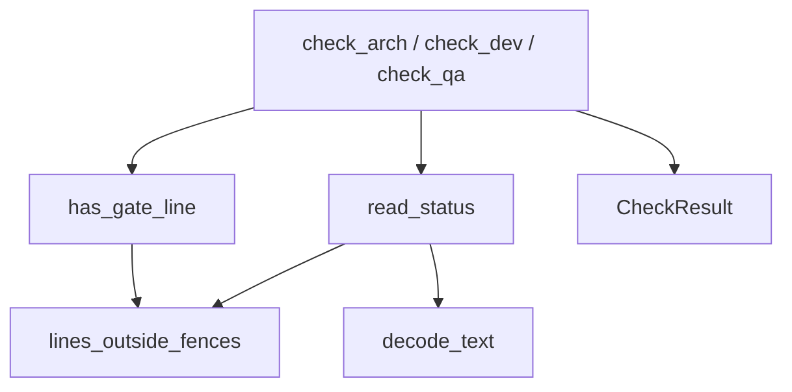

## Purpose

Pure functions that decide whether a chain skill may start. They take file text and return a verdict. They do no file reads, no hook framing and no environment reads, so a hook, a skill or a test can all call them and get the same answer. {src:hooks/gate_rules.py:1}

## Dependencies

Standard library only (`datetime`, `re`, `dataclasses`, `typing`). Nothing else in `hooks/` imports it yet. Tests: [test_gate_rules](../tests/hooks/test_gate_rules.md).

## Behavior

Approval line: the word `Approved`, a space, a dash (em dash, `-` or `--`), a space, then `YYYY-MM-DD`, then end of line. Trailing spaces and CRLF are fine. Extra text after the date fails. The date must be a real date and not after the injected `today`. The `Validated` line works the same way. {src:hooks/gate_rules.py:has_gate_line}

Lines inside fenced code blocks (backticks or tildes) never count. Bracketed placeholders never match because the date must parse. {src:hooks/gate_rules.py:lines_outside_fences}

`read_status` returns the first top-level `Status:` value from str or bytes. Malformed: missing, non UTF-8, empty, no `Status:` line, empty value, or two different values. {src:hooks/gate_rules.py:read_status}

Checks return `CheckResult(ok, reason)`. The reason names the file (`spec.md`, `design.md`, `edge-case-validation.md`, state file) and the expected line, never file contents.

| Skill | Passes when |
|---|---|
| arch | spec has the upper case approved Status value or an approval line, and state is `SPEC_APPROVED` |
| dev | design has an approval line, and state is `DESIGN_APPROVED`, `DESIGN_COMPLETE` or `IN_DEV` |
| qa | state is `DEV_COMPLETE`, spec and design have approval lines, validation file has a `Validated` line |

## Diagram: module level (L2, required)

## Notes

For qa the spec must carry an approval line; the Status form is accepted only for arch. A missing file is passed as `None` and reported as missing.
