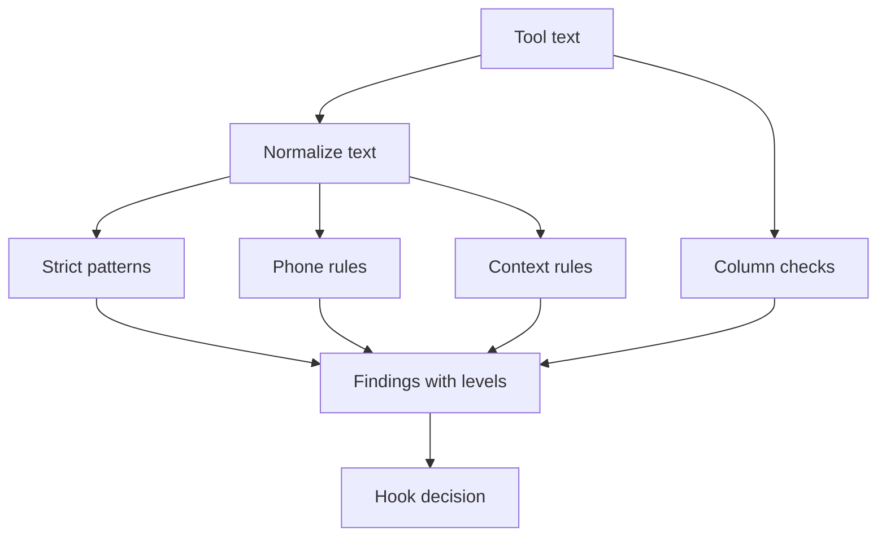

## Purpose

The one shared place for PHI detection and for pulling text out of tool payloads. It is not a hook. Hooks import it from the hooks directory. {src:hooks/phi_patterns.py:35} It holds the label and value patterns, the context rules, the column checks and the code that turns findings into PreToolUse output. {src:hooks/phi_patterns.py:scan_levels} {src:hooks/phi_patterns.py:pre_tool_decision}

## Dependencies

Standard library only: `json`, `re`, `unicodedata`, `dataclasses`, `enum`, `typing`. {src:hooks/phi_patterns.py:40-45}

Callers in `hooks/` that mention it: the PHI scan hooks for Write, Bash and tool results, the secrets scan hook, `sql_summary.py` and the vault inject hook. {unverified}

Tests: [test_phi_baseline](../tests/hooks/test_phi_baseline.md), [test_phi_context_rules](../tests/hooks/test_phi_context_rules.md), [test_phi_hook_levels](../tests/hooks/test_phi_hook_levels.md), [test_phi_qa_regressions](../tests/hooks/test_phi_qa_regressions.md), [test_phi_safety_speed](../tests/hooks/test_phi_safety_speed.md).

## Behavior

**Levels.** A finding is a label plus a level. `deny` blocks, `ask` prompts the user, `warn` only reports. {src:hooks/phi_patterns.py:Level} The strongest level wins. {src:hooks/phi_patterns.py:strongest_level} A label missing from the level map is treated as deny, so a new rule fails safe. {src:hooks/phi_patterns.py:_level_for}

| Label | Level |
|---|---|
| COLUMN, DOB, ADDRESS, NAME | deny |
| PHONE, CONTEXT | ask |
| PHONE_UNLABELED, CONTEXT_CLUE | warn |

{src:hooks/phi_patterns.py:LABEL_LEVELS}

**Strict rules.** `scan_for_phi` returns sorted labels for the patterns in `PHI_PATTERNS`. {src:hooks/phi_patterns.py:scan_for_phi} The labels are MRN, SSN, DOB, PATIENT_ID, NPI, INSURANCE_ID and ADDRESS. {src:hooks/phi_patterns.py:PHI_PATTERNS} Each is a label next to a value, except ADDRESS, which is a full street address with number, street words, suffix, city, two letter state and ZIP. {src:hooks/phi_patterns.py:_ADDRESS} DOB also matches a birth label followed by a month name date. {src:hooks/phi_patterns.py:PHI_PATTERNS} Patterns compile case insensitive. {src:hooks/phi_patterns.py:COMPILED}

**Phone rules.** The labeled phone rule is kept out of `PHI_PATTERNS`, so `scan_for_phi` never reports a phone number. {src:hooks/phi_patterns.py:LEVELED_PATTERNS} `scan_phone_labels` reports PHONE for a number next to a phone label. It reports PHONE_UNLABELED for a separated number with no label, after blanking any labeled number so it is not counted twice. {src:hooks/phi_patterns.py:scan_phone_labels}

**Normalization.** Non ASCII text first loses zero width characters, is folded with NFKC and has lookalike letters and punctuation mapped to ASCII. Pure ASCII text skips this. {src:hooks/phi_patterns.py:normalize_text}

**Context rules.** `scan_context` runs name rules and clue rules. A name after a patient style label gives NAME. {src:hooks/phi_patterns.py:name_label_level} A capitalized value denies unless it holds a generic form, team or system word, which gives ask. A value whose first word is a heading or placeholder word gives no finding. {src:hooks/phi_patterns.py:_value_level} Lowercase values after an explicit name label only ask. {src:hooks/phi_patterns.py:name_label_level}

Clue kinds are name, age and sex, event date, street part, phone and clinical term. {src:hooks/phi_patterns.py:collect_clues} Two clues of different kinds within 200 characters give CONTEXT. {src:hooks/phi_patterns.py:CONTEXT_WINDOW} {src:hooks/phi_patterns.py:paired_clues} Clues whose text overlaps never pair. {src:hooks/phi_patterns.py:_pairs_with} A lone name, age and sex, or event date clue gives CONTEXT_CLUE. A lone street part or clinical term gives nothing. {src:hooks/phi_patterns.py:WARN_ALONE_KINDS} The clinical term list holds generic words only. {src:hooks/phi_patterns.py:CLINICAL_TERMS} Text is scanned in chunks of 65536 characters that overlap by 1024. {src:hooks/phi_patterns.py:iter_chunks}

**Columns.** `phi_column` lowercases a name, removes spaces, underscores and dashes, then checks it against a token list by substring. {src:hooks/phi_patterns.py:phi_column} `fullname` is left out on purpose because a Unity Catalog name uses it. {src:hooks/phi_patterns.py:PHI_COLUMN_TOKENS} `scan_structured` flags a column only when it comes with data: a JSON key holding a non empty scalar, a statement result with column names and rows, or the header of a text table with a data row after it. {src:hooks/phi_patterns.py:_scan_json_node} {src:hooks/phi_patterns.py:_scan_text_table} In `scan_levels` a column finding reports as COLUMN, never with the column name. {src:hooks/phi_patterns.py:_structured_labels}

**Combined scan.** `scan_levels` merges the strict, column, phone and context findings and sorts them strongest first, then by label. Duplicate labels appear once. {src:hooks/phi_patterns.py:scan_levels}

**Hook output.** `pre_tool_decision` takes findings grouped by source name and returns nothing when there are none. {src:hooks/phi_patterns.py:pre_tool_decision} For deny or ask it returns a `permissionDecision` with a reason. For warn it returns a `systemMessage` and `additionalContext` and no permission decision, so the normal permission flow still runs. {src:hooks/phi_patterns.py:pre_tool_decision} Messages list labels and levels only, never the matched text. {src:hooks/phi_patterns.py:level_summary}

**Payload text.** `collect_texts` walks a tool response and gathers the values under `stdout`, `stderr`, `output`, `text`, `result` and `content`, plus a nested `file.content`. {src:hooks/phi_patterns.py:_collect} `extract_response_texts` adds the whole serialized response as a fallback, so unknown payload shapes are still scanned. {src:hooks/phi_patterns.py:extract_response_texts}

## Diagram: module level (L2, required)

## Notes

Every repeat in the patterns has an upper bound so long runs of spaces, letters or digits cannot slow matching. {src:hooks/phi_patterns.py:47-88}

Column findings in `scan_structured` carry a `COLUMN:` prefix and the column name. `scan_levels` drops that name. {src:hooks/phi_patterns.py:_scan_json_node} {src:hooks/phi_patterns.py:_structured_labels}

Review fixes (name and date rules):

- NAME: a capitalized value after a patient label denies. If a word in the value is a generic form, team or system word (`NAME_ASK_WORDS`), it asks instead. Lowercase values only match after an explicit name label (`patient name:`) and only ask. Accented capitals are accepted. {src:hooks/phi_patterns.py:name_label_level}
- DOB: the label forms include dotted and dashed spellings, and the date forms include year first, dotted day first and eight digits, only right after a birth label. {src:hooks/phi_patterns.py:_DOB_DATE} {src:hooks/phi_patterns.py:_DOB_LABEL}
- PHONE: a label followed by up to 50 spaces (`PHONE_GAP_MAX`) before the number still matches. {src:hooks/phi_patterns.py:PHONE_GAP_MAX}

Still not detected:

- A lowercase name after a bare `patient:` label with no `name` word. {src:hooks/phi_patterns.py:_BARE_LABEL_VALUE}
- Names with no label, titles in other languages, and nicknames. {unverified}
- Lookalikes outside the small mapping table, and digits that NFKC does not fold to ASCII. {src:hooks/phi_patterns.py:LOOKALIKES}
- A birth date without a birth label, or a label and date further apart than the rule allows. The second birth date rule allows at most 3 spaces between them, and the general separator cap is 200. {src:hooks/phi_patterns.py:158} {src:hooks/phi_patterns.py:SEP_SPACE_MAX}
- Event dates more than one line away from the event word. {src:hooks/phi_patterns.py:_GAP}
