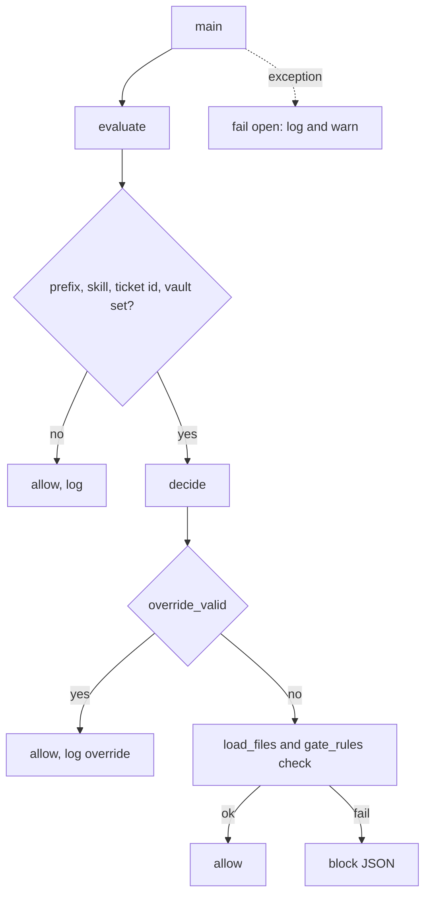

## Purpose

A UserPromptExpansion hook that stops the arch, dev and qa chain skills from starting when the earlier approval lines are missing. It reads the typed command and ticket id, loads the ticket files, and asks `gate_rules` for a verdict. {src:hooks/pre-prompt-expansion-check-gates.py:1}

## Dependencies

Standard library plus [gate_rules](gate_rules.md), imported at check time so an import error fails open. Tests: [test_gate_hook](../tests/hooks/test_gate_hook.md). Wired in `settings.json` under `UserPromptExpansion` with a 10 second timeout; the installer writes `ARBITER_SKILL_PREFIX`.

## Behavior

- Input: JSON on stdin with `command_name` and `command_args` (verified live on Claude Code 2.1.310 for a typed command). {src:tests/hooks/fixtures/pre-prompt-expansion-check-gates/tc-01-typed-arch.json}
- Skill name: `command_name` must be exactly `<ARBITER_SKILL_PREFIX>-<skill>` with skill one of the six chain skills. Anything else, or an unset prefix, is allowed. Only arch, dev and qa are gated. {src:hooks/pre-prompt-expansion-check-gates.py:skill_from_command}
- Ticket id: first argument token matching `^[A-Z][A-Z0-9]*-[0-9]+$`. None found, or `ARBITER_KNOWLEDGE` unset, allows and logs. {src:hooks/pre-prompt-expansion-check-gates.py:find_ticket_id}
- Files: `$ARBITER_KNOWLEDGE/02-tickets/{KEY}/{KEY}-state.md`, `-spec.md`, `-design.md`, `-edge-case-validation.md`. Each real path must sit under `02-tickets`, else the file counts as missing (or the whole command is allowed and logged if the ticket folder itself is outside). {src:hooks/pre-prompt-expansion-check-gates.py:is_under}
- Override: `{KEY}-gate-override.md` with `Override: <skill> YYYY-MM-DD <reason>`, valid for that skill and today only, reason required. Each use is logged. {src:hooks/pre-prompt-expansion-check-gates.py:override_valid}
- Block output: one JSON line `{"decision": "block", "reason": "..."}` on stdout, exit 0. The reason names the failed rule, the file paths involved, the skill to run first and the override file. It never prints file contents. {src:hooks/pre-prompt-expansion-check-gates.py:build_reason}
- Fail open: any exception (bad JSON, import error, rule error) is logged as one `fail_open` line to `ARBITER_GATE_LOG` (default `~/.arbiter/state/gate_check.log`), a short warning goes to stderr, and the exit code is 0. {src:hooks/pre-prompt-expansion-check-gates.py:main}
- Reads only, so it takes no lock.

## Diagram: module level (L2, required)

## Notes

The `decision: block` output shape comes from the Claude Code hooks documentation read during design, not from a live blocked run. Confirm in a live session that the reason is shown to the user. The override file can be written by the model; a write guard for it is a later block. An unset prefix writes a log line on every slash command until the installer sets `ARBITER_SKILL_PREFIX`; existing users re-run the installer.
