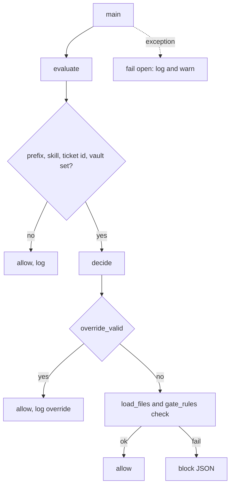

## Purpose

A UserPromptExpansion hook that stops the arch, dev and qa chain skills from starting when the earlier approval lines are missing. It reads the typed command and ticket id, loads the ticket files, and asks `gate_rules` for a verdict. {src:hooks/pre-prompt-expansion-check-gates.py:1}

## Dependencies

Standard library plus [gate_rules](gate_rules.md), imported at check time so an import error fails open. Tests: [test_gate_hook](../tests/hooks/test_gate_hook.md). Wired in `settings.json` under `UserPromptExpansion` with a 10 second timeout; the installer writes `ARBITER_SKILL_PREFIX`.

## Behavior

- Input: JSON on stdin with `command_name` and `command_args` (verified live on Claude Code 2.1.310 for a typed command). {src:tests/hooks/fixtures/pre-prompt-expansion-check-gates/tc-01-typed-arch.json}
- Skill name: `command_name` must be exactly `<ARBITER_SKILL_PREFIX>-<skill>` with skill one of the six chain skills. Anything else, or an unset prefix, is allowed. Only arch, dev and qa are gated. {src:hooks/pre-prompt-expansion-check-gates.py:skill_from_command}
- Ticket id: every argument token matching `^[A-Z][A-Z0-9]*-[0-9]+$` (case insensitive, uppercased) is a candidate, after trimming surrounding punctuation such as commas, brackets and quotes (so `T-001,` and `(T-001)` are gated). The first one whose real folder sits under `02-tickets` is used, so `UTF-8` and a symlinked folder pointing outside the vault are skipped. No candidate, no candidate folder, or `ARBITER_KNOWLEDGE` unset allows and logs. {src:hooks/pre-prompt-expansion-check-gates.py:first_existing_ticket}
- Files: `$ARBITER_KNOWLEDGE/02-tickets/{KEY}/{KEY}-state.md`, `-spec.md`, `-design.md`, `-edge-case-validation.md`. Each real path must sit under `02-tickets`, else the file counts as missing (or the whole command is allowed and logged if the ticket folder itself is outside). {src:hooks/pre-prompt-expansion-check-gates.py:is_under}
- Override: `{KEY}-gate-override.md` with `Override: <skill> YYYY-MM-DD <reason>`, valid for that skill and today only, reason required, ASCII digits only. Lines inside fenced code blocks are ignored (same fence rules as `gate_rules`), a leading BOM is stripped, and a symlinked override file is refused with an `override_refused` log line. Each use is logged. {src:hooks/pre-prompt-expansion-check-gates.py:override_valid}
- Block output: one JSON line `{"decision": "block", "reason": "..."}` on stdout, exit 0. The reason names the failed rule, the expected value, the file paths involved, the skill to run first and the override file. It never prints anything read from a file, including the `Status:` value. A file that exists but gives permission denied is listed as not readable, apart from a missing file (the log line gets ` unreadable`). {src:hooks/pre-prompt-expansion-check-gates.py:build_reason}
- Fail open: any exception (bad JSON, import error, rule error) is logged as one `fail_open` line to `ARBITER_GATE_LOG` (default `~/.arbiter/state/gate_check.log`), a short warning goes to stderr, and the exit code is 0. {src:hooks/pre-prompt-expansion-check-gates.py:main}
- Reads only, so it takes no lock.

### Create the override and read the audit log

The model cannot write `*-gate-override.md` (the write guard denies it, see `docs/hooks.md` section 4). The owner creates it from a terminal. Example with the fake ticket `T-001`:

```
printf 'Override: arch %s hotfix for demo\n' "$(date +%F)" >> "$ARBITER_KNOWLEDGE/02-tickets/T-001/T-001-gate-override.md"
```

Log line format in `ARBITER_GATE_LOG`: `<YYYY-MM-DDTHH:MM:SS> <event> <detail>`. Events: `override <skill> <KEY>`, `block <skill> <KEY>` (plus ` unreadable`), `override_refused symlink <KEY>`, `allow <reason>`, `fail_open <ErrorName>: <message>`. Example: `2026-11-03T09:15:02 override arch T-001`.

The Bash tool remains an uncovered route: a shell command from the model can still create the file. The override guards against accidents, not against a determined actor.

## Diagram: module level (L2, required)



## Notes

The `decision: block` output shape comes from the Claude Code hooks documentation read during design, not from a live blocked run. Confirm in a live session that the reason is shown to the user. The override file is protected from the Write, Edit and MultiEdit tools by the write guard, not from the Bash tool. An unset prefix writes a log line on every slash command until the installer sets `ARBITER_SKILL_PREFIX`; existing users re-run the installer.
