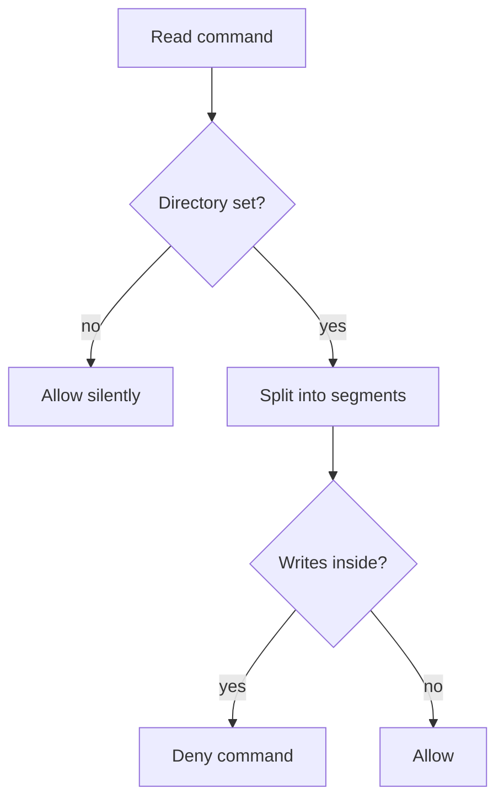

## Purpose

A PreToolUse hook for Bash. It denies a command that writes into the read-only code directory named by `ARBITER_CODE_DIR`. {src:hooks/pre-tool-bash-guard-code-dir.py:5} It is the Bash side of a pair. The Write, Edit and MultiEdit side is [pre-tool-write-guard-path](pre-tool-write-guard-path.md). {src:hooks/pre-tool-write-guard-path.sh:6}

## Dependencies

Standard library only: `json`, `os`, `shlex`, `sys`. {src:hooks/pre-tool-bash-guard-code-dir.py:30-33} It reads the environment variable `ARBITER_CODE_DIR` and the PreToolUse JSON on stdin (`tool_input.command` and `cwd`). {src:hooks/pre-tool-bash-guard-code-dir.py:main} Tests: [test_guard_hooks](../tests/hooks/test_guard_hooks.md).

## Behavior

**Switched off when unset.** If `ARBITER_CODE_DIR` is empty the hook exits 0 with no output. {src:hooks/pre-tool-bash-guard-code-dir.py:178-180} It stays silent because the write guard prints the warning. {src:hooks/pre-tool-bash-guard-code-dir.py:24}

**Fails open.** Any exception, including bad input, ends in exit 0, so Bash stays usable if the hook breaks. {src:hooks/pre-tool-bash-guard-code-dir.py:189-193}

**Preparing the command.** The code directory is resolved with `realpath`. The text `$ARBITER_CODE_DIR` and `${ARBITER_CODE_DIR}` in the command is replaced by that path. {src:hooks/pre-tool-bash-guard-code-dir.py:185-186} The command is tokenized with `shlex`, falling back to a plain whitespace split if the quotes are unbalanced. {src:hooks/pre-tool-bash-guard-code-dir.py:tokenize} It is split into segments at `;`, `&` and `|`. {src:hooks/pre-tool-bash-guard-code-dir.py:split_segments}

**Path test.** A path counts as inside when, after `~` expansion and resolving relative paths against the tracked working directory, its `realpath` equals the code directory or sits below it. A word starting with `-` never counts. {src:hooks/pre-tool-bash-guard-code-dir.py:inside}

**Per segment, a violation is any of these.**

| Case | Rule |
|---|---|
| Output redirect (`>`, `>>`, `&>`) | the next word is inside {src:hooks/pre-tool-bash-guard-code-dir.py:redirect_hits} |
| `rm`, `mv`, `touch`, `tee`, `mkdir`, `rmdir`, `truncate`, `dd`, `chmod`, `chown` | any argument is inside {src:hooks/pre-tool-bash-guard-code-dir.py:WRITE_VERBS} |
| `sed` with `-i`, a flag group holding `i`, or `--in-place` | any argument is inside {src:hooks/pre-tool-bash-guard-code-dir.py:sed_in_place} |
| `cp`, `install`, `ln` | the last argument, or a `-t` or `--target-directory` value, is inside. Sources may be read. {src:hooks/pre-tool-bash-guard-code-dir.py:destination_hit} |
| `git` | the target is inside (a path argument, `-C`, or the working directory) and the subcommand is not on the read only list {src:hooks/pre-tool-bash-guard-code-dir.py:git_writes} |

The read only git list is `status`, `log`, `diff`, `show`, `ls-files`, `ls-tree`, `rev-parse`, `blame`, `grep`, `describe`, `cat-file`, `shortlog`, `remote`, `config`, `version`, `help`. {src:hooks/pre-tool-bash-guard-code-dir.py:GIT_READ_ONLY} A leading `VAR=value` word or a wrapper (`sudo`, `command`, `env`, `time`, `nice`, `nohup`, `exec`) is skipped before the verb is read. {src:hooks/pre-tool-bash-guard-code-dir.py:command_words}

**Working directory tracking.** After each segment, a `cd` or `pushd` with a target moves the tracked directory for later segments. {src:hooks/pre-tool-bash-guard-code-dir.py:next_cwd}

**Deny output.** A violation prints a deny with a fixed reason and exits 0. {src:hooks/pre-tool-bash-guard-code-dir.py:deny}

## Diagram: module level (L2, required)

## Notes

Not caught, per the source header: paths built from other variables expanded later, command substitution, obfuscated or encoded paths, scripts that write there internally, interpreters writing through code (`python -c`, `perl -e`), symlinks created after the check, and tools that take the target from a config file. {src:hooks/pre-tool-bash-guard-code-dir.py:19-23}

The matching is conservative text matching on the command, not a sandbox. {src:hooks/pre-tool-bash-guard-code-dir.py:15-19}
