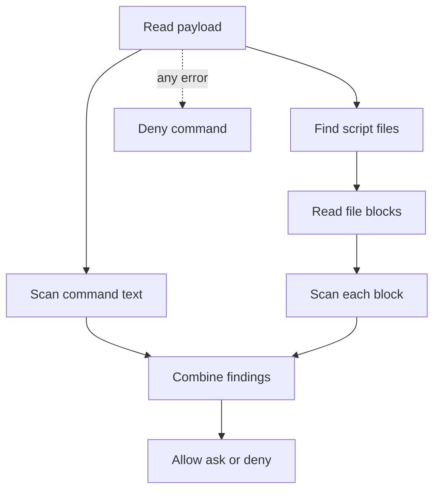

## Purpose

A PreToolUse hook for Bash. It scans the command text, and the script files the command names, with the shared PHI rules, and decides deny, ask or warn from the strongest finding. {src:hooks/pre-tool-bash-scan-phi.py:main} It exists so PHI typed into a command, or sitting in a script the command runs, is caught before the command runs. The script files are only read, never run. {src:hooks/pre-tool-bash-scan-phi.py:scan_script}

## Dependencies

Imports `LEVEL_RANK`, `pre_tool_decision` and `scan_levels` from [phi_patterns](phi_patterns.md), with the hooks directory added to the path. {src:hooks/pre-tool-bash-scan-phi.py:316} The rest is standard library: `glob`, `itertools`, `json`, `os`, `re`, `shlex`, `stat`, `sys`. {src:hooks/pre-tool-bash-scan-phi.py:47-55}

Input is the PreToolUse JSON on stdin, using `tool_input.command` and `cwd`. {src:hooks/pre-tool-bash-scan-phi.py:318-323} Tests: [test_phi_hook_levels](../tests/hooks/test_phi_hook_levels.md), [test_phi_safety_speed](../tests/hooks/test_phi_safety_speed.md), [test_phi_qa_regressions](../tests/hooks/test_phi_qa_regressions.md).

## Behavior

**Main flow.** An empty command returns with no output. {src:hooks/pre-tool-bash-scan-phi.py:320} Otherwise the command text is scanned as the source `Bash command text`. Each script path found adds a source named `script file` plus the base name. {src:hooks/pre-tool-bash-scan-phi.py:322-326} `pre_tool_decision` turns the sources into output, and the hook prints it only when there is one. {src:hooks/pre-tool-bash-scan-phi.py:327-329}

**Fails closed.** Any exception in `main` (bad JSON, import error, scan error) prints a deny with an internal error message, and the process still exits 0. {src:hooks/pre-tool-bash-scan-phi.py:340-347}

**Finding script files.** The command is split with `shlex` into segments at operators. Words after a plain `<` redirect are collected as files too. {src:hooks/pre-tool-bash-scan-phi.py:split_command} If one quote is unbalanced, the hook parses line by line, and a line that still fails is split on whitespace. {src:hooks/pre-tool-bash-scan-phi.py:_tokens_with_line_fallback}

For each segment the hook skips leading `VAR=value` words and wrapper commands with their flags (`sudo`, `env`, `timeout`, `nice`, `ionice`, `stdbuf`, `nohup`, `time`, `exec`, `command`, and `uv run`). {src:hooks/pre-tool-bash-scan-phi.py:strip_wrappers} Then:

- For `python`, `bash`, `sh`, `zsh`, `node`, `ruby` or `perl`, the script is the first non option argument. Inline code flags and a lone `-` mean no script. Flags that take a separate value are skipped. {src:hooks/pre-tool-bash-scan-phi.py:script_arg}
- For `source` or `.`, the script is the next word. {src:hooks/pre-tool-bash-scan-phi.py:script_in_segment}
- For a command word that holds a slash, that word is the script. After `uv run`, a word ending in `.py` also counts. {src:hooks/pre-tool-bash-scan-phi.py:script_in_segment}

**Path resolution.** `~` and variables set in the hook's own environment are expanded. A word that still holds `$` or a backtick names no file. Relative paths join the working directory. {src:hooks/pre-tool-bash-scan-phi.py:resolve_raw_path} A glob expands to at most 10 matches, kept only if each is a regular file of 1 MB or less. {src:hooks/pre-tool-bash-scan-phi.py:MAX_GLOB_MATCHES} {src:hooks/pre-tool-bash-scan-phi.py:_is_small_regular_file} At most 10 files are scanned per command, without duplicates. {src:hooks/pre-tool-bash-scan-phi.py:script_paths}

**Reading a file.** A file larger than 256 KB is read in blocks of that size, each starting with the last 1024 bytes of the block before. A file with a null byte in its first 8192 bytes is treated as binary and yields nothing. {src:hooks/pre-tool-bash-scan-phi.py:iter_file_blocks} A missing or unreadable file, a file that is not a regular file, or a path the system rejects gives no findings, so these cases never block. {src:hooks/pre-tool-bash-scan-phi.py:scan_script}

**Long commands.** A command longer than 32768 characters is not parsed, so it names no script files. Its text is still scanned in full. {src:hooks/pre-tool-bash-scan-phi.py:script_paths} {src:hooks/pre-tool-bash-scan-phi.py:322}

## Diagram: module level (L2, required)

## Notes

Known limits, as stated in the source header. PHI a script builds, fetches or writes at run time is not in the command or the file. Split or encoded strings dodge the patterns. Scripts reached through a variable set inside the command, `cd`, `-m module`, `xargs`, pipes or command substitution are not found. A glob past the caps is only partly read. The file can change after the scan. {src:hooks/pre-tool-bash-scan-phi.py:35-39}

A broken hook blocks every Bash command, so fix it in an editor outside Claude Code. {src:hooks/pre-tool-bash-scan-phi.py:41-42}

The post tool hook that scans what a command prints is a separate file. {src:hooks/pre-tool-bash-scan-phi.py:40}
