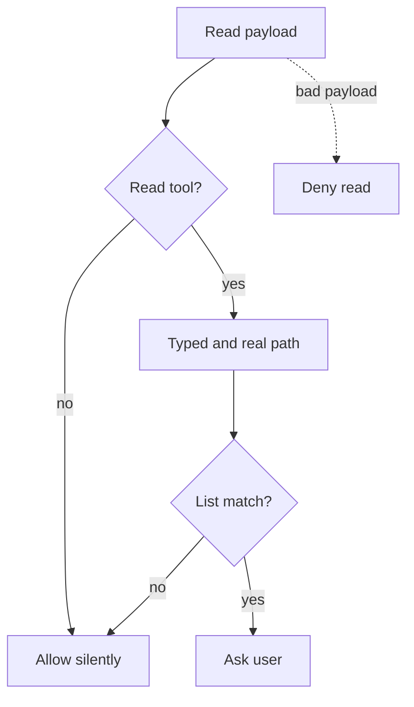

## Purpose

A PreToolUse hook for the Read tool. It asks the user before Claude reads a file whose path is on a sensitive path list. {src:hooks/pre-tool-read-ask-sensitive-path.py:5} It looks at the path only and never at the file content. The post read PHI scan still covers content. {src:hooks/pre-tool-read-ask-sensitive-path.py:13}

## Dependencies

Standard library only: `fnmatch`, `json`, `os`, `posixpath`, `sys`. {src:hooks/pre-tool-read-ask-sensitive-path.py:27-31} It does not import `read_guard_common.py`; that module serves the read before write guard. {src:hooks/read_guard_common.py:10}

Environment: `ARBITER_SENSITIVE_PATHS`, a comma separated list of extra patterns. {src:hooks/pre-tool-read-ask-sensitive-path.py:EXTRA_PATTERNS_ENV} Input is the PreToolUse JSON on stdin, using `tool_name` and `tool_input.file_path`. {src:hooks/pre-tool-read-ask-sensitive-path.py:main} Tests: [test_read_path_hook](../tests/hooks/test_read_path_hook.md).

## Behavior

**The list.** The defaults are `.env`, `*.pem`, `*.key` and `.ssh/`. {src:hooks/pre-tool-read-ask-sensitive-path.py:DEFAULT_PATTERNS} Extra patterns from the environment are added to the defaults and cannot remove one. {src:hooks/pre-tool-read-ask-sensitive-path.py:active_patterns} Entries are trimmed, a leading `~` is expanded, blanks are dropped and everything is lowercased. {src:hooks/pre-tool-read-ask-sensitive-path.py:active_patterns}

**Pattern forms.** {src:hooks/pre-tool-read-ask-sensitive-path.py:matches}

| Pattern | Matches against |
|---|---|
| Text ending in a slash | the path, when that folder name appears as a whole path part |
| Glob with a slash | the whole path |
| Name or glob with no slash | the file name only |

The name and glob forms use `fnmatch.fnmatchcase` on lowercase text. The folder form is a plain substring test on the lowercase path, with the folder wrapped in slashes, and does not use `fnmatch`. Case is ignored overall. {src:hooks/pre-tool-read-ask-sensitive-path.py:68-72}

**Path forms.** Two forms of the path are checked: the typed path after `~` expansion and normalization, and its symlink resolved path. A match on either counts. {src:hooks/pre-tool-read-ask-sensitive-path.py:path_forms} {src:hooks/pre-tool-read-ask-sensitive-path.py:first_match}

**Decision.** A tool other than Read, or an empty path, exits 0 with no output. {src:hooks/pre-tool-read-ask-sensitive-path.py:92-93} A match prints `permissionDecision: ask` with a reason that names the matching pattern, then exits 0. {src:hooks/pre-tool-read-ask-sensitive-path.py:95-98} No match exits 0 with no output. {src:hooks/pre-tool-read-ask-sensitive-path.py:99}

**Fails closed.** A payload that cannot be parsed or has the wrong shape prints a deny. {src:hooks/pre-tool-read-ask-sensitive-path.py:85-90} Any other exception in the run also prints a deny. {src:hooks/pre-tool-read-ask-sensitive-path.py:102-107}

## Diagram: module level (L2, required)

## Notes

Not covered, per the source header: Bash reads such as `cat` and `head`, Grep and Glob. {src:hooks/pre-tool-read-ask-sensitive-path.py:22}

The list is text matching, not file type detection. A sensitive file whose name matches no entry is not asked about. {src:hooks/pre-tool-read-ask-sensitive-path.py:matches}

A folder pattern also matches when the path is the folder itself, because a trailing slash is added to the path before the check. {src:hooks/pre-tool-read-ask-sensitive-path.py:70}
