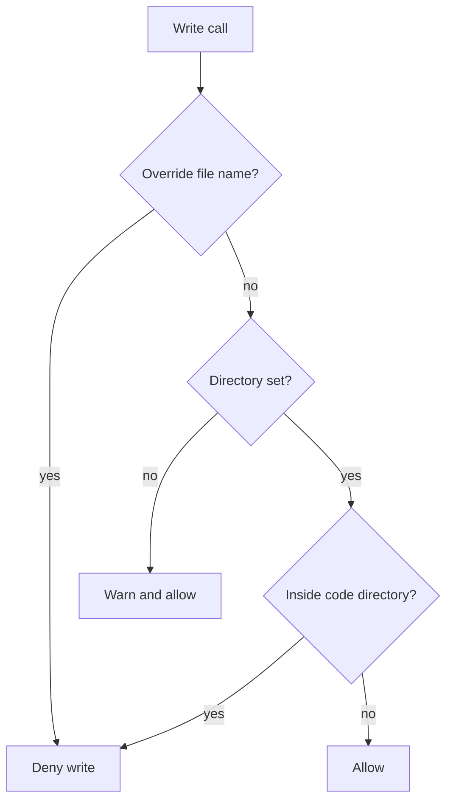

## Purpose

A PreToolUse hook for Write, Edit and MultiEdit. It blocks two kinds of write. One is a write into the read-only code directory named by `ARBITER_CODE_DIR`. The other is any model write to a file named `*-gate-override.md`, which the owner creates from a terminal. {src:hooks/pre-tool-write-guard-path.sh:4-5} Bash commands are covered by [pre-tool-bash-guard-code-dir](pre-tool-bash-guard-code-dir.md). {src:hooks/pre-tool-write-guard-path.sh:6}

## Dependencies

External commands: `python3` (JSON parsing and `realpath`), `basename` and `tr`. {src:hooks/pre-tool-write-guard-path.sh:13-28} Environment: `ARBITER_CODE_DIR`. {src:hooks/pre-tool-write-guard-path.sh:50} Input is the PreToolUse JSON on stdin. {src:hooks/pre-tool-write-guard-path.sh:11}

Tests: [test_guard_hooks](../tests/hooks/test_guard_hooks.md).

## Behavior

**Reading the path.** The hook takes `tool_input.file_path`, or `notebook_path` when that is empty. If parsing fails, the path is empty. {src:hooks/pre-tool-write-guard-path.sh:13-21}

**Gate override check, first.** If a path was found, the hook lowercases the typed file name and the file name of the symlink resolved path. If either ends in `-gate-override.md` it prints a deny and exits 0. {src:hooks/pre-tool-write-guard-path.sh:26-44} This runs before the code directory check, so it holds even when `ARBITER_CODE_DIR` is unset. {src:hooks/pre-tool-write-guard-path.sh:23-25}

**Unset code directory.** If `ARBITER_CODE_DIR` is empty the hook never blocks. It writes a warning to stderr and prints a `systemMessage` with the same text, then exits 0. {src:hooks/pre-tool-write-guard-path.sh:50-55} This happens even when the path is empty, because the check comes before the empty path check. {src:hooks/pre-tool-write-guard-path.sh:57-59}

**Empty path.** With the variable set and no path, the hook exits 0. {src:hooks/pre-tool-write-guard-path.sh:57-59}

**Code directory check.** Both the code directory and the target path go through `os.path.realpath`. {src:hooks/pre-tool-write-guard-path.sh:63-64} A trailing slash is added to the code directory so a sibling folder with a longer name does not match. {src:hooks/pre-tool-write-guard-path.sh:66-67} The write is denied when the target is the code directory or below it. {src:hooks/pre-tool-write-guard-path.sh:69-80}

**Exit codes.** Every path ends with `exit 0`. A block is a printed deny, not a non zero exit. {src:hooks/pre-tool-write-guard-path.sh:83}

## Diagram

## Notes

The override check covers Write, Edit and MultiEdit only. A Bash command can still create the override file, so the check guards against accidents. {src:docs/hooks.md:section 4}

If `python3` is missing or fails, the path parses as empty and the write is allowed. {src:hooks/pre-tool-write-guard-path.sh:13-21}

The `realpath` calls fall back to the raw text if `python3` fails. {src:hooks/pre-tool-write-guard-path.sh:63-64}
