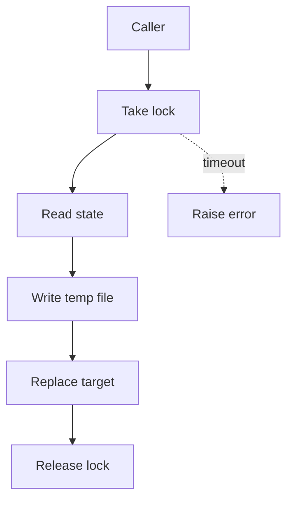

## Purpose

Two helpers for hooks that read, change and rewrite a shared state file. `write_state_atomic` writes to a temp file and then replaces the target in one step, so a reader never sees half a file. `locked_state` holds a lock so a whole read, change and write cycle is not interleaved with another process. {src:hooks/state_file_io.py:1-9} It is not a hook.

## Dependencies

Standard library only: `contextlib`, `fcntl`, `logging`, `os`, `tempfile`, `time`, `typing`. {src:hooks/state_file_io.py:13-19} Locking uses `fcntl.flock`, so it works on POSIX only. {src:hooks/state_file_io.py:6}

Tests: [test_state_file_io](../tests/hooks/test_state_file_io.md). The gate hook tests also import it. {unverified}

## Behavior

**`write_state_atomic(path, content)`.**

1. Creates a temp file in the same directory as the target, so the final replace is a rename on the same volume. {src:hooks/state_file_io.py:write_state_atomic}
2. Writes the content as UTF-8, flushes and calls `fsync`. {src:hooks/state_file_io.py:43-46}
3. Replaces the target with `os.replace`. {src:hooks/state_file_io.py:47}

On any failure, including `BaseException`, the temp file is removed, an error is logged and the exception is raised again. The original file is unchanged. {src:hooks/state_file_io.py:48-51} A missing temp file during cleanup is ignored. {src:hooks/state_file_io.py:_remove_quietly} Temp files are named with the prefix `.state-` and the suffix `.tmp`. {src:hooks/state_file_io.py:24-25}

**`locked_state(path, timeout_seconds)`.** A context manager that holds an exclusive lock for the length of the `with` block. The lock lives in a sibling file named `path` plus `.lock`, opened in append mode. {src:hooks/state_file_io.py:locked_state} The default timeout is 10 seconds. {src:hooks/state_file_io.py:21} The lock is released and the lock file closed when the block ends, including on an error. {src:hooks/state_file_io.py:73-78}

**Waiting.** The lock is taken without blocking. If it is busy, the code retries every 0.05 seconds. When the deadline passes it logs an error and raises `TimeoutError`. {src:hooks/state_file_io.py:_acquire_lock}

## Diagram: module level (L2, required)

## Notes

The two helpers are independent. `write_state_atomic` does not take the lock, so a caller that needs a safe read, change and write cycle must wrap the cycle in `locked_state` itself. {src:hooks/state_file_io.py:write_state_atomic}

The lock file is never deleted. {src:hooks/state_file_io.py:locked_state}

The lock covers processes that use these helpers. It does not stop a writer that skips them. {src:hooks/state_file_io.py:6-7}
