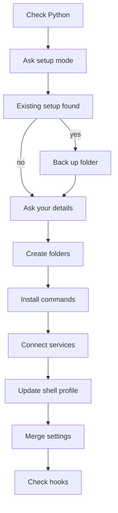

## Purpose

One time setup for a new machine. It asks a few questions, creates the notes vault and working folders, installs the skill commands and a personal `CLAUDE.md`, optionally connects Jira, Notion and Slack, adds an environment block to the shell profile, merges the hooks into `~/.claude/settings.json`, and optionally builds the vault search index. {src:install.sh:1} It is safe to run again: it backs files up and skips work already done. {src:install.sh:3}

## Dependencies

| Need | Use |
|---|---|
| `python3` 3.9 or newer | Checked by running it, not by `command -v`, because the macOS stub exists but fails. Exit 1 if it fails {src:install.sh:49} |
| `installer/merge_settings.py` and `settings.json` | The settings merge {src:install.sh:1328}. See [merge_settings](installer/merge_settings.md) and [settings](settings.md) |
| `git` | Optional. Scripts folder tracking and repo cloning, skipped with a note if missing {src:install.sh:700} |
| `security` (macOS), `secret-tool` or a secrets file (Linux), `cmdkey` (Windows shells) | Credential storage {src:install.sh:cred_store} |
| `claude` CLI, `npx` | Optional. Register the MCP servers {src:install.sh:1152} |
| `pip`, `rag/build_index.py` | Optional search index {src:install.sh:1235} |

Setup guide: [setup](setup.md).

## Behavior

Flags and environment:

- `--non-interactive` or `ARBITER_NONINTERACTIVE=1`: every prompt takes its default, service connections are skipped, and an existing setup is always migrated, never cleaned. {src:install.sh:13} The script wraps `read` so that prompt reads return an empty answer, and the migrate or clean question returns `m`. {src:install.sh:read}
- `--dry-run`: prints what would change and exits 0 before any file is written or any secret is asked for. {src:install.sh:535}
- Strict mode is on: `set -euo pipefail`. {src:install.sh:4}

Prompts, in order:

1. Press Enter to start. {src:install.sh:298}
2. Advanced setup, yes or no. Default no, which means simple mode. {src:install.sh:306}
3. If `~/.claude` already has content: keep and update, or start fresh (simple mode); or migrate or clean (advanced mode). Start fresh sets clean mode, which wipes `~/.claude` after a verified backup. {src:install.sh:335} {src:install.sh:372}
4. Advanced migrate only: confirm the migration plan. {src:install.sh:502}
5. Name, job title, company, industry. Name is required and re-asked until given. {src:install.sh:566}
6. Advanced only: skill prefix. Simple mode derives it from the initials of the name, at most three letters, falling back to `dt`. A saved or detected prefix wins over the one derived from initials. {src:install.sh:577} {src:install.sh:579}
7. Notes folder path, simple mode. Advanced mode asks for a base folder instead. {src:install.sh:612}
8. Advanced only: track scripts with git, a scripts repo URL, repo URLs to mirror, Cursor rule on or off per rule, a code reference directory. {src:install.sh:697}
9. For Jira and Confluence, Notion: browser sign in, API key or skip. For Slack: API key or skip. {src:install.sh:993} {src:install.sh:1048}
10. Simple mode asks whether to set up vault search. Advanced mode always does. {src:install.sh:1218}

Saved answers: name, title, company, domain, prefix, base folder and code folder go to `~/.claude/arbiter-config` and are read back on the next run. {src:install.sh:589} {src:install.sh:655} {src:install.sh:957}

Existing setup handling: the whole `~/.claude` folder is copied to `~/.claude.backup.<timestamp>` and the file counts are compared. {src:install.sh:backup_claude_dir} Clean mode wipes `~/.claude` only after a verified backup, and exits 1 if the backup fails. {src:install.sh:421} {src:install.sh:clean_claude_dir} Migrate mode keeps memory files and copies custom skills into `commands/custom`. {src:install.sh:882} {src:install.sh:894}

Folders it creates, under the base folder (default `$HOME/Developer/<name-slug>`): {src:install.sh:605}

- The notes vault, which sits in the base folder unless you type another path in simple mode or reuse a detected vault in advanced mode. {src:install.sh:612} {src:install.sh:630} It holds `00-landing`, `01-system-map` (with `clients`, `pipelines`, `architecture`, `data-model`, `platform-learning`), `02-tickets`, `03-knowledge-base` (with `decisions`, `learnings`, `patterns`), `04-education`, `05-claude-conversations`, `06-meetings-summaries`, `07-workflows`, `memory`, `output`. {src:install.sh:VAULT_DIRS}
- `<prefix>-scripts`, `<prefix>-code` (read only mirror) and `<prefix>-dev` (working checkouts). {src:install.sh:622} {src:install.sh:689}

Files it writes or changes:

| Target | What |
|---|---|
| `~/.claude/commands/` | Skill files, with `ticket`, `support`, `spec`, `arch`, `dev`, `qa` renamed to `<prefix>-name`, and name, company and prefix filled in {src:install.sh:798} |
| `~/.claude/CLAUDE.md` | Rendered from the repo `CLAUDE.md` with identity and paths filled in {src:install.sh:937} |
| `~/.claude/projects/<slug>/memory` | A symlink to the repo `memory` folder {src:install.sh:787} |
| `<vault>/.cursor/rules` and `rules-disabled` | Cursor rules, enabled or disabled {src:install.sh:822} |
| `~/.claude/credentials.sh` | A loader script that reads tokens from the OS store and exports them. It holds no token values {src:install.sh:1068} |
| Shell profile | A block marked `# Arbiter (prefix: ...)`. Old blocks in `.zshrc`, `.bash_profile`, `.bashrc` and `.profile` are removed first, with a dated backup {src:install.sh:1196} |
| `<base>/<prefix>.code-workspace` | VS Code workspace with the vault, repo and scripts folders {src:install.sh:1289} |
| `~/.claude/settings.json` | Merged hooks and permissions, after a dated copy {src:install.sh:1325} |
| `<vault>/.rag_index` | Search index, if chosen {src:install.sh:1242} |

Environment variables written to the shell profile: `<PREFIX>_KNOWLEDGE`, `<PREFIX>_MEETINGS`, `<PREFIX>_SCRIPTS`, `ARBITER_KNOWLEDGE`, `CLAUDE_DOTFILES`, `ARBITER_CODE_DIR`, plus a line that sources `credentials.sh`. {src:install.sh:1183} The profile file is `.zshrc` for zsh, `.bash_profile` or `.bashrc` for bash, `.profile` otherwise. {src:install.sh:1176} The settings `env` block gets only four values: `ARBITER_KNOWLEDGE`, `ARBITER_CODE_DIR`, `CLAUDE_DOTFILES` and `ARBITER_SKILL_PREFIX`, so editors started without the shell profile still work. The `<PREFIX>_` variables are not in it. {src:install.sh:1319} {src:installer/merge_settings.py:144}

Tokens: they are never written to a file by the script's normal path. On macOS the `security` tool prompts on the terminal, so the value is not in the process list. {src:install.sh:121} On Linux they go to Secret Service if `secret-tool` exists, otherwise to `~/.claude/.secrets` created with owner only permissions. {src:install.sh:126} {src:install.sh:133} On Windows shells they go to Credential Manager through `cmdkey`, which receives the token on its command line, where other processes on the machine can see it. {src:install.sh:143} The loader reads from the same store at shell start. {src:install.sh:1078}

Services: the Atlassian and Notion browser option registers a remote server with `claude mcp add --scope user`. API key options register an `npx` command that sources `credentials.sh`. Slack has no browser option. {src:install.sh:1156} {src:install.sh:1164} If the `claude` CLI is missing it prints a note and skips all registration. {src:install.sh:1152} Non interactive mode always skips services. {src:install.sh:173}

Hook permissions: before the merge it runs `chmod +x` on every file in the repo `hooks` folder. {src:install.sh:1322}

Verification: after the merge, the script checks that each hook path in `~/.claude/settings.json` is executable and prints a note for each one that is not. It does not exit non zero for that. {src:install.sh:1337} {src:install.sh:1352}

Exit behavior:

| Exit | When |
|---|---|
| 1 | `python3` missing or older than 3.9 {src:install.sh:52} |
| 1 | Clean mode and the backup failed {src:install.sh:422} |
| 1 | Clean aborted because no verified backup exists {src:install.sh:429} |
| 0 | Migration plan declined {src:install.sh:507} |
| 0 | Dry run finished {src:install.sh:547} |
| 0 | Normal finish. Any other failing command stops the script through `set -e` {src:install.sh:4} |

What it does NOT do:

- It does not write token values to any repo or config file on macOS, and it does not accept a token as a script argument. The Windows `cmdkey` call is the exception noted above. {src:install.sh:119}
- It does not wipe `~/.claude` in non interactive mode. {src:install.sh:38}
- It does not post to Jira, Notion or Slack. It only stores credentials and registers servers. {src:install.sh:1164}
- It does not install the git hooks into other repos. It prints the copy command only in advanced mode. {src:install.sh:1258}
- It does not move the repo folder. It suggests a `mv` command in advanced mode. {src:install.sh:647}
- It does not install Node, git or the Claude CLI. It prints a note when they are missing. {src:install.sh:1146}
- It does nothing at all to disk in dry run. {src:install.sh:535}

## Diagram

## Notes

Needs bash. Reads use a function that overrides the `read` builtin. {src:install.sh:26} The end to end test runs the script on macOS system bash 3.2. {src:docs/hooks.md:569}

Disagreements and risks found in the code:

- The script says tokens live in the keychain and not in files. {src:install.sh:1118} On Linux without `secret-tool` they are stored in a file, `~/.claude/.secrets`. {src:install.sh:129}
- Non interactive mode with no `git config user.name` and no saved name loops forever. The name prompt returns an empty answer and the loop asks again. {src:install.sh:567} {src:install.sh:41}
- In dry run, the setup mode and existing setup prompts still run, and the backup step only prints. {src:install.sh:301} {src:install.sh:238}
- Advanced mode resets `CODE_DIR` to the answer of a later prompt, after the `<prefix>-code` folder was already created, so the guarded path can differ from the created folder. {src:install.sh:689} {src:install.sh:945}
