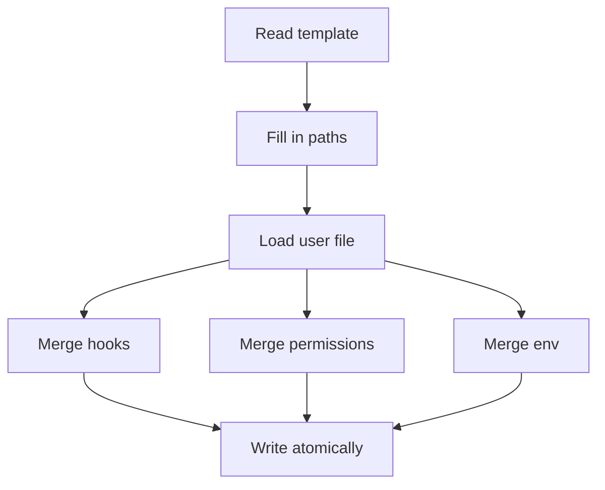

## Purpose

Merges the repo `settings.json` template into the user's `~/.claude/settings.json` without losing the user's own settings. It replaced an earlier text overwrite that discarded every user key. {src:installer/merge_settings.py:11-12} It is a command line script, run by the installer. {src:installer/merge_settings.py:main}

## Dependencies

Standard library only: `json`, `os`, `shlex`, `sys`, `tempfile`. {src:installer/merge_settings.py:32} Called from [install](../install.md) with six paths and a skill prefix. {src:install.sh:1328} The template it reads is described in [settings](../settings.md). Tests: `tests/hooks/test_hooks.py` covers the settings merge. {src:docs/hooks.md:568}

## Behavior

Command line: `merge_settings.py TEMPLATE TARGET REPO_DIR VAULT_DIR SCRIPTS_DIR CODE_DIR [SKILL_PREFIX]`. With the wrong number of arguments it prints the usage line and returns 2. {src:installer/merge_settings.py:main}

Steps in `main`:

1. Read the template JSON. A missing or invalid template is not caught, so Python raises. {src:installer/merge_settings.py:140}
2. Replace `$CLAUDE_DOTFILES`, `$ARBITER_KNOWLEDGE` and `$ARBITER_SCRIPTS` inside every string of the parsed tree, so a path with quotes cannot break the JSON. {src:installer/merge_settings.py:substitute}
3. Build the env values: `ARBITER_KNOWLEDGE`, `ARBITER_CODE_DIR`, `CLAUDE_DOTFILES`. Add `ARBITER_SKILL_PREFIX` when a non empty prefix is passed. {src:installer/merge_settings.py:144}
4. Load the existing target file with `load_user`, then merge. {src:installer/merge_settings.py:147}
5. If a prefix argument was passed but is empty, remove `ARBITER_SKILL_PREFIX` from env. If the argument is omitted, the existing value stays. {src:installer/merge_settings.py:148}
6. Write the result atomically and return 0. {src:installer/merge_settings.py:150}

Merge rules in `merge`:

| Part | Rule |
|---|---|
| `hooks` | Arbiter owned groups are dropped from the user's hooks, then the template groups are appended. User groups are kept. {src:installer/merge_settings.py:merge_hooks} |
| `permissions` list keys (`allow`, `ask`, `deny`, `additionalDirectories`) | Union, user items first, order kept. {src:installer/merge_settings.py:union} |
| other `permissions` keys | User value wins. {src:installer/merge_settings.py:105} |
| `env` | User keys, then template keys, then the installer values. The installer values win on a clash. {src:installer/merge_settings.py:107} |
| any other key | User value wins. The template adds keys the user lacks. {src:installer/merge_settings.py:98} |

A hook group is Arbiter owned when any of its commands has a file name that also appears in the template. The file name is the first word of the command after `shlex` splitting, with its folder removed. This is how stale paths from a moved repo get replaced. {src:installer/merge_settings.py:command_basename} An event left with no groups after removal is dropped before the template groups are added. {src:installer/merge_settings.py:83}

`load_user` returns an empty dict when the target is missing. When the file cannot be read or is not valid JSON, it prints a message to stderr and starts from empty. {src:installer/merge_settings.py:load_user} A file that holds valid JSON that is not an object also gives an empty dict, with no message. {src:installer/merge_settings.py:117} The backup is made by the caller before the script runs. {src:install.sh:1325}

`write_atomic` resolves symlinks to the real file, creates the folder if needed, writes a temp file in the same folder, then swaps it in with `os.replace`. The output is indented by two spaces with a final newline. {src:installer/merge_settings.py:write_atomic}

## Diagram: module level (L2, required)

## Diagram: function level (L3, optional)

Skipped. The merge is straight line except for the hook ownership check, which the table above covers.

## Notes

Ownership is by file name only. A user hook whose script has the same file name as an Arbiter hook, in any folder, is removed on every merge. {src:installer/merge_settings.py:82}

The temp file is created with `tempfile.mkstemp`, which makes it readable only by its owner, so the settings file ends up with owner only permissions after a merge. {src:docs:https://docs.python.org/3/library/tempfile.html#tempfile.mkstemp}

The merge is idempotent for hooks: running it twice leaves one copy of each Arbiter group. {src:installer/merge_settings.py:merge_hooks}

The prefix value is stripped of surrounding whitespace before the empty check. {src:installer/merge_settings.py:139}
