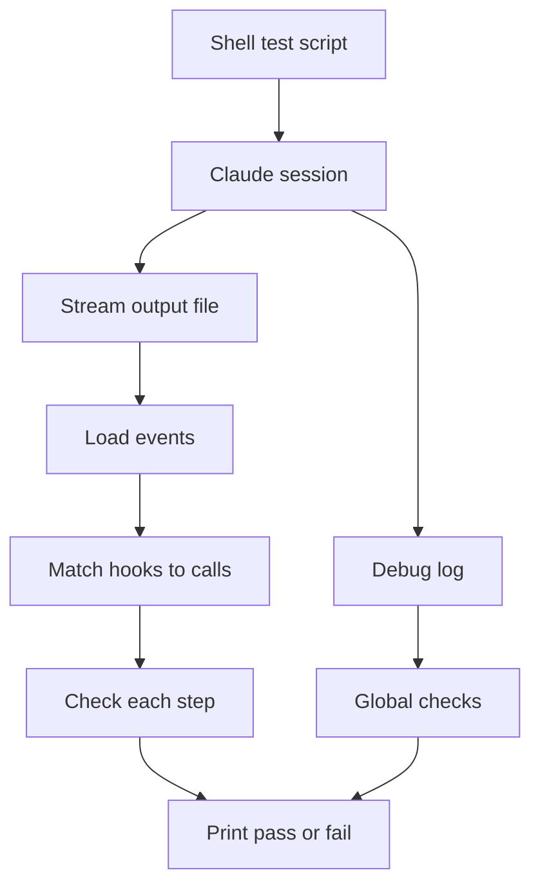

## Purpose

Reads the stream-json output of a real Claude Code session and checks that each hook fired and that its message reached the model. {src:tests/e2e/check_stream.py:5} It is the assertion step of the end to end test in `tests/e2e/run.sh`. {src:tests/e2e/run.sh:69}

## Dependencies

Uses only the Python standard library: `json`, `os`, `sys` and `typing.Callable`. {src:tests/e2e/check_stream.py:19-22} It reads two files from the work folder, `stream.jsonl` and `debug.log`. {src:tests/e2e/check_stream.py:load_events} It is called by `tests/e2e/run.sh` after a session started with `claude -p` that uses only the settings written by the installer. {src:tests/e2e/run.sh:62-65}

How to run: the whole test is `tests/e2e/run.sh`, which installs into a throwaway home, writes synthetic fixtures, runs one Claude session and then calls this script. {src:tests/e2e/run.sh:10-16} The run costs one Claude session of about 1 to 2 minutes and needs the `claude` command logged in. {src:tests/e2e/run.sh:18-19} Artifacts stay in the work folder (`ARBITER_E2E_DIR` or a new temp folder). {src:tests/e2e/run.sh:25} Run only the checker on an existing work folder with `check_stream.py WORK_DIR SANDBOX_DIR CODE_DIR`. {src:tests/e2e/check_stream.py:14}

## Behavior

- `STEPS` maps eight step names to four things: a test that finds the tool call, the hook name expected, the text expected in that hook's output, and a file that must not exist. {src:tests/e2e/check_stream.py:STEPS}
  - S1 and S2: PHI in Bash output and in a Read result gets a warning from the after-tool hook. {src:tests/e2e/check_stream.py:27-31}
  - S3: a secret on stderr gets a security warning. {src:tests/e2e/check_stream.py:32-33}
  - S4 and S6: a PHI Write and a PHI Bash command are blocked, and the target file must not exist in the sandbox. {src:tests/e2e/check_stream.py:34-39}
  - S5: a Write into the code directory is blocked, and the file must not exist there. {src:tests/e2e/check_stream.py:36-37}
  - S7: a Databricks file read is denied with the approval summary. {src:tests/e2e/check_stream.py:40-41}
  - S8: PHI columns in a CSV give a column warning. {src:tests/e2e/check_stream.py:42-43}
- `load_events` reads each line that starts with a brace from `stream.jsonl` as a JSON event. {src:tests/e2e/check_stream.py:load_events}
- `attribute_hooks` links hook events to tool calls by stream order, because hook events carry no tool call id. A hook response is added to the most recent tool call, and only hooks whose name contains "ToolUse" count. {src:tests/e2e/check_stream.py:attribute_hooks} This only works because the prompt asks for one tool call per step. {src:tests/e2e/check_stream.py:11-12}
- `check_step` takes the first tool call that matches the step and fails if the model never tried it, if no hook output of the right name has the expected text, or if the file that must not exist was created. {src:tests/e2e/check_stream.py:check_step}
- `global_checks` adds two checks: every hook response has outcome success, and `debug.log` has no line containing "validation failed". {src:tests/e2e/check_stream.py:global_checks}
- `main` prints PASS or FAIL for each of the ten checks and a count. It returns 0 only when all pass, otherwise 1. {src:tests/e2e/check_stream.py:main}

A FAIL means one of five things: the model skipped the step, the hook did not fire or its text did not arrive, a blocked file was written anyway, a hook response had an outcome other than success, or `debug.log` holds a "validation failed" line. {src:tests/e2e/check_stream.py:83-86}

## Diagram: module level (L2, required)

## Notes

The expected hook text sits in the values of the `STEPS` tuple, so a reworded hook message breaks the matching step even when the hook still works. {src:tests/e2e/check_stream.py:27-44} Order based matching can misattribute hooks if the model runs more than one tool call per step. {src:tests/e2e/check_stream.py:10-12} A step the model never attempts counts as a failure, so a model refusal looks like a hook fault. {src:tests/e2e/check_stream.py:check_step} The check for S7 does not verify that no Databricks call ran; it only checks the denial text. {src:tests/e2e/check_stream.py:40-41}
